# Lab 5

## Recorded scope — 2026-10-20

I stopped work after the local portability audit. This repository keeps the
work and evidence completed so far; it does not claim that all Lab 5 tasks
are finished.

| Task | Recorded result |
| --- | --- |
| 1 — Managed pipeline | The normal path, failed evaluation gate, and invalid-data path were checked on Azure. CI run 10 also completed the full pipeline. |
| 2 — Scoped identities | The permission table and one permission-removal/recovery experiment are recorded below. |
| 3 — Scheduled retraining | One scheduled run completed. The trigger comparison and worst-case discussion are included. |
| 4 — Portability | The local audit passed. The second-provider demonstration and portability write-up were not completed. |
| 5 — Cost accounting | The [pre-run estimate](reports/lab5-cost.md) is saved. Actual billing, the full comparison, and measured optimisation results are incomplete. |
| 6 — Teardown | Not performed. |
| 7–9 — LLM evaluation, guardrails, and token costs | Not implemented. |

The latest local check passed the portability audit, 510 tests, and Ruff.
The changed image/test paths have not been checked in a new image build or CI
run. Some evidence and the audit changes are newer than the last deployed image.

**Cloud resources remain.** The last recorded checks on 19 October showed CI
disabled, the retraining schedule disabled, and compute at zero nodes. These
are historical checks, not a current cloud inspection or proof of zero cost.
Stopping this work or pushing Git does not delete Azure resources. Cleanup
needs a separate review of exact targets, including resources shared with
other labs and FeedbackPulse.

## Task 1 — Managed pipeline

### Three managed paths checked — 2026-10-15

I checked the normal path and two cases that should stop the pipeline. All
three used the same digest-pinned pipeline image from commit `aa6a4cd`, with
one submission per case.

| Case | What happened | Effect on staging | Evidence |
| --- | --- | --- | --- |
| Normal data, gate **0.80** | All six steps completed: ingest → validate → train → evaluate → register → deploy staging. Validation ROC-AUC was **0.844499**. | Registered and deployed model **3** to `lab5-staging--0000002`, healthy with 100% traffic. | [Full run](reports/lab5-full-pipeline-aa6a4cd.json) |
| Same data, test gate **0.90** | Ingest, validate, and train completed. Evaluate rejected **0.844499 < 0.90** with exit code **1**. No register or deploy child job was created. | Stayed on model **3**; no new model version or deployment. | [Gate rejection](reports/lab5-negative-gate-aa6a4cd.json) |
| One copied row with **load_pct = 250.0** | Ingest completed. Validate rejected the value outside **0–100** with exit code **1**. No train, evaluate, register, or deploy child job was created. | Stayed on model **3**; no new model version or deployment. | [Data rejection](reports/lab5-invalid-data-aa6a4cd.json) |

Azure labels both negative runs **Failed**. That is the expected result: the
checks stopped bad input or a below-threshold score before registration and
deployment. The normal gate remains **0.80**; **0.90** was only a test setting.
This is a fixed quality floor, not a comparison with the current staging model.

A separate [HTTP smoke check](reports/lab5-model3-http-smoke.json) passed
`/health`, `/ready`, and one `/predict` request, all reporting model **3**.
It was not part of the deploy step, so the original `deployment.json` correctly
keeps `http_smoke_tested: false`. This was one serving check, not an accuracy
or load benchmark. The invalid-data run covered one out-of-range value, not
every possible data error; the original dataset and DVC metadata were unchanged.

Compute returned to zero current and target nodes after each run. The last
recorded check was **14:15:59 Thailand time (07:15:59 UTC)**. Storage and shared
resources remain, so this does not mean all Azure costs stopped. These results
cover the three Task 1 paths, not completion of every Lab 5 task.

### Implementation and earlier checkpoints

The notes below keep the earlier setup, failures, and fixes. Their pending
items describe those checkpoints; the three-path summary above is the latest
result. Earlier failed jobs are not relabelled as successful.

I added a [configuration example](cloud.env.example), a
[config loader](cloudlayer/azure_config.py), and [scope guards](cloudlayer/lab5_scope.py)
for `lab5-staging` in the shared `feedbackpulse-env` environment. The guards
check the reviewed resource IDs and Lab 5 ownership tags. The shared environment
is not a Lab 5 update or deletion target.

**Checks:** All 438 offline tests and Ruff passed on 2026-10-13, using Python 3.11.16
from the existing Lab 2 environment. Run these from `lab/lab5/`:

```bash
PYTHONDONTWRITEBYTECODE=1 PYTEST_DISABLE_PLUGIN_AUTOLOAD=1 \
  ../lab2/.venv/bin/python -m pytest -q -p no:cacheprovider tests cloudlayer/tests

PYTHONDONTWRITEBYTECODE=1 \
  ../lab2/.venv/bin/python -m ruff check --no-cache \
  --config ../lab4/ruff.toml src cloudlayer scripts tests
```

**Earlier image checks (2026-10-15, `4dfb85d`):** After the revision-state fix below, all 75
offline staging tests and Ruff passed for the adapter and its tests. The new
local pipeline image then passed the full **452-test** suite with networking
disabled. The 438-test result above is the earlier check from 2026-10-13.

**Latest deployment fix (2026-10-15):** The adapter now also accepts `ScaledToZero`
with health `Healthy` and zero replicas. All **91 offline staging tests** and
Ruff passed. The fix was committed as `aa6a4cd` and built into the local
`linux/amd64` image `itcs355-lab5:pipeline-aa6a4cd`. All **91 staging tests**
also passed inside that image with networking disabled. After pushing it to ACR,
one deploy-only job completed and wrote `deployment.json` with
`revision_state: scaled_to_zero` and `http_smoke_tested: false`. This verifies
the managed deploy step, not HTTP readiness or the full pipeline. A separate
[HTTP smoke check](reports/lab5-post-deploy-http-smoke.json) then passed
`/health`, `/ready`, and one `/predict` request with model version 2. The 452-test
result above belongs to the older image.

The [pre-run cost estimate](reports/lab5-cost.md) was committed at `18f4ad4`
before this implementation work.

The two Lab 5 containers and datastores are
created and checked, along with the training, release, and runtime identities.
Their details and screenshots are recorded below. The identities now have four
container-scoped storage assignments and three registry-scoped `AcrPull` assignments.
Training also has a custom model-registration role on the existing ML workspace.
Runtime has a four-action custom role to read workspace, model, and artifact
metadata. Release now
has Environment read/join access, a custom read/assign role on the Lab 5
runtime identity, and App read/write plus revision-read access only on
`lab5-staging`. It still has no ML workspace role. Runtime previously loaded
model version 2, and that version passed the three HTTP smoke checks.
Training and release are attached to `cpu-lab5`, which was checked with zero
current and target nodes after the latest job. Runtime is now attached to
`lab5-staging`. Its model revision first failed because runtime could not read
MLflow artifact metadata. After adding that permission, one deploy-only retry
and one approved restart still left the old revision in `ActivationFailed`.
A separately approved new revision, `lab5-staging--model2-readfix-1014`, then
loaded the same model with the same image and became healthy. HTTPS ingress
still allows only the approved current `/32` IP. That earlier check was a direct
revision recovery, not an end-to-end managed pipeline run. The later full run
below completed and deployed model version 3.
The pipeline image from `4dfb85d` passed all 452 offline tests and is now
in ACR with a verified manifest digest. One deploy-only job used it on 2026-10-15.
The App update and approved IP change succeeded, but the job timed out because
the adapter did not accept `ScaledToZero` together with health `Healthy`.
It produced no `deployment.json`; see the
[updated-adapter result](reports/lab5-deploy-only-updated-adapter.json).
The missing idle-state case is now fixed and tested in the local `aa6a4cd`
image, which has now been pushed to ACR, with all other deployment checks
unchanged. One separately approved deploy-only run with that image completed
and verified the existing scaled-to-zero revision; see the
[successful deploy-only result](reports/lab5-deploy-only-scaled-zero-success.json).
No HTTP request was sent in that deploy-only attempt. The separate HTTP check
afterward passed; its result is recorded below. Earlier failed jobs stay failed.
The later full-run verification is recorded separately below.
The earlier image was used for the older live runs below. The first live pipeline passed ingest, validate, train,
and the evaluation gate, then failed at registration because the training
identity lacked `Microsoft.MachineLearningServices/workspaces/models/write`.
No model version was found afterward, and staging deployment did not start.
After approval, I added that one action to the existing training role and checked
that its workspace scope and assignment were unchanged. One approved retry passed
the same four steps, but registration reported another missing action:
`Microsoft.MachineLearningServices/workspaces/metadata/artifacts/write`.
No Lab 5 model version was found and staging did not start. On 2026-10-14, I added
only that artifact-write action to the existing training role. The role then
had seven actions, with its scope and assignment unchanged. A registration-only
job then reused the latest model and gate, but failed because artifact-read
permission was also missing. Version 1 was saved with matching files and tags,
but that job produced no `registration.json` and did not complete registration.
After approval, I added only artifact-read permission to the same role. It now
has eight actions, with the same workspace scope and training assignment.
One register-only retry then completed and wrote `registration.json` for
`itcs355-u6688124-lab5:2`. Registry read-back and all five model-file hashes
matched the source. Version 1 was left unchanged; no new training was run.
See the [retry record](reports/lab5-pipeline-retry.json) and the
[failed registration-only record](reports/lab5-register-only.json), followed by
the [successful registration-only retry](reports/lab5-register-only-retry.json).
The 2026-10-14 preflight found that the previously approved IP no longer matched
the current connection. After approval, I updated only the allowed IP in the
Git-ignored `cloud.env` and checked that the effective configuration passed.
One deploy-only job used the updated configuration and model version 2, but failed
while pulling the pipeline image from ACR, before the deployment command started.
That first job left the placeholder unchanged; see the
[deploy-only result](reports/lab5-deploy-only.json). After approval, I added
`AcrPull` for release on the existing ACR and ran one deploy-only retry. It
passed image preparation and updated the App, but runtime model loading failed
with HTTP 403 for `Microsoft.MachineLearningServices/workspaces/metadata/artifacts/read`.
The revision returned `/ready` 503 and failed activation; the job hit its time
limit without writing `deployment.json`. I stopped that attempt for review; see
the [retry result](reports/lab5-deploy-only-retry.json). After further approval,
I added only the missing runtime read action and ran deploy-only once more.
The App update reused the failed revision. One separately approved restart
reported `Succeeded`, but the revision stayed `ActivationFailed` and the job
timed out. See the [runtime-read retry](reports/lab5-runtime-read-retry.json).
The [new-revision recovery](reports/lab5-new-revision-recovery.json) then passed
`/health`, `/ready`, and one `/predict` request, all with model version 2.
Compute stayed at zero nodes during that recovery. See the
[first-run record](reports/lab5-first-pipeline-run.json) and the checkpoints
below. Registration and runtime serving first had separate live evidence.
The later full pipeline and both managed negative paths are now recorded in
the three-path summary above and the detailed run sections below.

### Ingest and validate

I added local [ingest and validate commands](src/data_steps.py) using the
[Lab 4 data contract](src/data.py). The original 6,000-row dataset passed, and
the input and output SHA-256 hashes matched. These commands were first checked
locally, then ran as Azure ML steps in the managed runs recorded below.

Run from `lab/lab5/`, using the existing local Lab 2 dataset:

```bash
lab5_run_dir=$(mktemp -d /tmp/lab5-data-check.XXXXXX)
PYTHONDONTWRITEBYTECODE=1 ../lab2/.venv/bin/python -m src.data_steps ingest \
  --input ../lab2/data/raw/sensors.csv --output "$lab5_run_dir/ingest"
PYTHONDONTWRITEBYTECODE=1 ../lab2/.venv/bin/python -m src.data_steps validate \
  --input "$lab5_run_dir/ingest/sensors.csv" --output "$lab5_run_dir/validated"
```

Each step writes a CSV copy and a JSON report. Missing or invalid data makes
validation fail without publishing a validated copy. Output folders must be
empty; these commands do not overwrite the source or earlier results.

### Local training

I connected [training](src/train.py) to the validated dataset using the selected
Lab 2 settings: 100 trees, max depth 12, minimum leaf size 10, and seed 20260101.
One local run gave validation ROC-AUC **0.844499** and test ROC-AUC **0.846673**.
Reloading the saved model gave the same scores. This was a local check with
uncommitted code, not an Azure pipeline run.

After the ingest/validate commands above, run in the same shell:

```bash
PYTHONDONTWRITEBYTECODE=1 PYTHONHASHSEED=20260101 \
  ../lab2/.venv/bin/python -m src.train \
  --validated-dir "$lab5_run_dir/validated" \
  --dvc-metadata-path ../lab2/data/raw.dvc \
  --output-dir "$lab5_run_dir/train"
```

The output contains `model/` in MLflow format and `metrics.json`. A failed
validation report or changed CSV stops training. The [saved local result](reports/lab5-local-training.json)
records parameters, metrics, the data fingerprint, the supplied DVC directory
version, and the Git revision marked `dirty`. Model files are not included in Git.
The original training check reported 9 deprecation warnings from the existing
MLflow/Pydantic dependencies. The later 414-test suite, including the Azure SDK
checks, reported 1,045 warnings. The latest full-suite result is recorded under
storage bindings below; no dependencies were changed.

### Local evaluation gate

I added a [gate](scripts/evaluation_gate.py) using validation ROC-AUC with a
minimum of **0.80**. This is our lab quality floor, not a threshold set by the
instructor or proof that the model beats the current production model.

The existing score of **0.844499** passed. Using **0.90** for the negative check
returned exit code 1 without changing the score or retraining. Missing or invalid
metrics also fail. The gate is now a dependency of registration in the compiled
pipeline. That failure path has not yet been checked in a live Azure ML run.

After the training command above, run in the same shell. The normal check uses
0.80 and returns exit code 0 for the recorded score:

```bash
PYTHONDONTWRITEBYTECODE=1 ../lab2/.venv/bin/python scripts/evaluation_gate.py \
  --metrics "$lab5_run_dir/train/metrics.json"
```

The stricter check below should fail with exit code 1. It tests the failure path;
it does not change the normal 0.80 floor or show that the model got worse:

```bash
PYTHONDONTWRITEBYTECODE=1 ../lab2/.venv/bin/python scripts/evaluation_gate.py \
  --metrics "$lab5_run_dir/train/metrics.json" --min-auc 0.90
```

To check the saved score without training again, use
`--metrics reports/lab5-local-training.json` in either command.

### Registration checks

I connected the gate to the [registration code](cloudlayer/azure_registry.py).
Failed checks stop before any registry call. New training exports include file
hashes and matching model metadata, so mixed or changed files are rejected.

Passing tests sent the model and lineage to a mock registry and checked the
returned version. Registry errors did not report success. This was an offline
check, not a real Azure registration. The earlier training result is unchanged
and does not contain the new hashes, so it cannot pass these registration checks.

The function requires an explicitly supplied registry client. It targets the
separate `itcs355-u6688124-lab5` model and does not promote or deploy anything.
It is now connected in the local pipeline definition, not a submitted job. The
[registration tests](cloudlayer/tests/test_registration.py) and the existing
[tiny training test](cloudlayer/tests/test_training_registration.py) check this path without calling Azure.

### Step handoffs

I added file handoffs for the next pipeline steps. Training accepts a Git SHA
with `--git-commit` when `.git` is not available and records it as supplied
lineage, not proof of the image contents. With local Git, a mismatched SHA or
dirty state is rejected. Without this option, training still reads local Git
and records uncommitted changes as `-dirty`.

The gate writes `gate.json` tied to the exact training metrics. After training,
use a new, empty output folder to save the decision:

```bash
PYTHONDONTWRITEBYTECODE=1 ../lab2/.venv/bin/python scripts/evaluation_gate.py \
  --metrics "$lab5_run_dir/train/metrics.json" --output-dir "$lab5_run_dir/gate"
```

A failed gate does not write a pass report. An existing output folder with files
is rejected, not overwritten. Stop if the command fails; do not reuse an older
gate report.

The registration command requires that report and writes the verified model
name and version to `registration.json`. It uses `--training-dir`, `--gate-report`,
and `--output-dir`; it does not select `latest`. **This is a cloud-write command,
so do not run it in this local-only step.** To view its arguments without logging
in or calling Azure:

```bash
PYTHONDONTWRITEBYTECODE=1 ../lab2/.venv/bin/python -m cloudlayer.azure_registry --help
```

A tiny-data test passed through ingest, validate, train, gate, and a mock
registry. No Azure job or real registration was run. The steps now have bindings
in the locally compiled pipeline. The earlier 6,000-row training result is
unchanged.

### Staging deployment checks

I added a [staging adapter](cloudlayer/azure_staging.py) using the Lab 4 serving
setup. It reads the exact model name and numbered version from `registration.json`,
not `latest`. It only targets `lab5-staging`, with a digest-pinned image, 0.5 CPU,
1 GiB memory, and zero to one replica. Access is limited to one configured public
IPv4 address with `/32`; missing settings stop before authentication.

The shared environment and Lab 5 runtime identity must already exist and pass
the scope checks. The adapter reads them but does not change them or add roles.
An existing App without the right Lab 5 tags is rejected. No Lab 2–4 code changed.

The [offline tests](cloudlayer/tests/test_staging.py) checked the request body, version
handoff, access rules, and revision read-back. Wrong versions, permission errors,
failed revisions, and timeouts did not report success. The adapter sends one
deployment request and waits up to 600 seconds for revision checks; it does not
automatically redeploy or delete anything after failure.

`deployment.json` records the endpoint, image, model version, and revision state.
It explicitly says `http_smoke_tested: false`. A healthy or scaled-to-zero revision
reported by Azure is not proof that a prediction request works. Live image
compatibility, model loading, permissions, and HTTP checks still need verification.

This was tested with fake credentials and mocked HTTP responses, not Azure.
The CLI is a cloud-write command and has not been run against the cloud. To view
its arguments safely from `lab/lab5/`:

```bash
PYTHONDONTWRITEBYTECODE=1 ../lab2/.venv/bin/python -m cloudlayer.azure_staging --help
```

The adapter uses the existing Python HTTP and identity libraries rather than
requiring an Azure CLI login inside the pipeline container. The request fields
follow Microsoft's [Container Apps create/update API](https://learn.microsoft.com/en-us/rest/api/resource-manager/containerapps/container-apps/create-or-update?view=rest-resource-manager-containerapps-2025-07-01)
and [revision API](https://learn.microsoft.com/en-us/rest/api/resource-manager/containerapps/container-apps-revisions/get-revision?view=rest-resource-manager-containerapps-2025-07-01).

### Local pipeline compilation

I connected the six steps in [pipeline/pipeline.yaml](pipeline/pipeline.yaml):
ingest, validate, train, evaluate, register, and deploy to staging. This file
describes the commands and file handoffs without Azure resource settings.
The [Azure compiler](cloudlayer/pipelines.py) adds those settings and creates
an Azure ML pipeline object and local YAML. It does not upload files, log in,
submit a job, create resources, or set a schedule.

Register must receive the gate's output, and deploy must receive that run's
`registration.json`. I set `continue_on_step_failure: false` so a failed step
stops the pipeline. Each run is configured to rerun the steps instead of reusing
cached results. These are Azure ML settings, not proof of a cloud run; see
Microsoft's [pipeline job reference](https://learn.microsoft.com/en-us/azure/machine-learning/reference-yaml-job-pipeline?view=azureml-api-2).

**Checks:** The 36 new [compiler tests](cloudlayer/tests/test_pipelines.py) used the installed
Azure ML SDK with network and credential calls blocked. They checked all six
steps, actual input/output bindings, identity references, and YAML save/load.
Running the compiled gate command locally with 0.90 returned 1 and wrote no pass
report. This did not test Azure's scheduler or deploy anything.

**Problems and fixes:** SDK 1.35.0 has no `dsl.condition`, so I used the required
file dependencies and pipeline failure setting. Its YAML export also added
`azureml:` to local input paths. The exporter preserves the two original local
file paths, and tests check that the loaded YAML still points to those files.
It refuses to overwrite an existing output file.

To see the compiler arguments safely, run from `lab/lab5/`:

```bash
PYTHONDONTWRITEBYTECODE=1 ../lab2/.venv/bin/python -m cloudlayer.pipelines --help
```

Compilation requires local data and DVC metadata files, a full Git SHA, a
digest-pinned pipeline image, a compute name, training/release identity client
IDs, and complete staging settings. These must be reviewed before live use;
the test values are not real deployment settings. Code must be inside the image,
not uploaded from the working folder. A supplied SHA does not prove what is in
that image. The local image checks are recorded below. Live use of the configured
compute and identities, permissions, failure handling, and the staging HTTP check still need
verification. Task 1 is not finished yet.

### Pipeline image and local checks

I prepared a [Dockerfile](Dockerfile) for the Lab 5 step code, using the pinned
Python 3.11 base and non-root setup from Lab 2 at `18f4ad4`. The
[dependency input](requirements.in) keeps the same pins, and
[requirements.txt](requirements.txt) is byte-for-byte identical to Lab 2's lock.
No dependency pins changed, and nothing was installed into the host environment.
The inherited lock still includes some DVC and test tools that these pipeline
steps do not need.

The recipe copies `src/`, `cloudlayer/`, and `scripts/`. The pipeline chooses
which command to run; the image's default command only shows Python help.
The [.dockerignore](.dockerignore) excludes local credentials and run outputs.
A build must supply a full Git SHA through `GIT_COMMIT`. The recipe checks its
format; I also compared the 13 Python source files inside this image with the
committed source. All file hashes matched.

The 10 new [recipe tests](tests/test_image_recipe.py) checked the pinned base,
lock hashes, copy scope, defaults, exclusions, and the small SHA-check snippet.
All 414 offline tests and Ruff passed on the host before the source commit.

I then built `itcs355-lab5:pipeline-9766879` for `linux/amd64` on 2026-10-13,
using source commit `9766879e586090893b6b3ce1f4ffb427e868a180`. The image's
revision label matches that commit. From `lab/lab5/` at that source revision:

```bash
docker buildx build --platform linux/amd64 \
  --build-arg GIT_COMMIT=9766879e586090893b6b3ce1f4ffb427e868a180 \
  --tag itcs355-lab5:pipeline-9766879 --load .
```

The local image ID is
`sha256:f99c8ca6dd888167cbe8de057a01402f3062a811f771a534fe58eacf5d8ccf47`.
This is not an ACR manifest digest. The build reused cached dependency layers,
so it did not test a fresh download and installation of every package.

**Container checks:** `pip check` passed. Imports and `--help` worked for all six
step command modules, even from `/tmp`. The non-root `runner` user (UID 10001)
could write to a temporary output mount prepared with matching ownership.
The same 414 tests passed inside the image in 16.05 seconds, with 1,045 dependency
warnings. The tests used the code baked into the image, not a source-code mount.
Both container checks ran with networking disabled, a read-only root filesystem,
and no credentials mounted. Azure calls in the test suite were mocked.

This confirms the local image works for these checks. It does not prove Azure ML
output-mount permissions, cloud authentication, registry access, or a live
pipeline run. No Git or image push was made, and no Azure job was run.

### Cloud prerequisites — read-only check

On 2026-10-13, I checked the existing resources without submitting a job or
changing Azure settings.

| Item | What I found |
|---|---|
| Shared services | The workspace, storage account, and Basic ACR reported `Succeeded`. ACR admin access is disabled. |
| Staging environment | `feedbackpulse-env` reported `Succeeded` with a Consumption profile. It stays shared and unchanged. |
| Compute | The workspace compute list was empty. The Lab 2 and Lab 4 clusters were already removed during their teardown. |
| Lab 5 identities and App | No Lab 5 user-assigned identities or `lab5-staging` App appeared in the resource-group inventory. |

The Azure ML Malaysia West size list includes `Standard_F2s_v2` (2 vCPUs, 4 GiB),
but not the handout's `Standard_B2s`. The AML quota response showed 0 of 16
Dedicated regional vCPUs used, 0 of 16 FSv2 Dedicated vCPUs used, and a regional
Low-priority limit of 0. These are the returned AML limits, not a promise that
Azure can allocate a VM. The existing estimate's F2s_v2 Dedicated plan remains
a candidate, with zero minimum nodes and one maximum node; nothing was created.
Microsoft notes that [AML supports a specific set of VM sizes](https://learn.microsoft.com/en-us/azure/machine-learning/concept-compute-target?view=azureml-api-2#supported-vm-series-and-sizes),
which can differ from ordinary Azure VMs.

Before a live run, we still need the pipeline image in ACR with its real manifest
digest, a configured compute target, and reviewed training, release, and serving
identities with scoped access. The serving image digest and allowed IP also need
review. The workspace returned its MLflow tracking URI, but no live Lab 5
`cloud.env` was created. The four datastores present at that check reported `AccountKey` authentication;
I did not retrieve any keys or change them. That setup is not evidence of
identity-scoped data access. Task 2's permission-removal test is still separate.

**Tool issue:** The installed CLI `ml` extension could not load. I used core CLI
GET/list commands with a temporary empty extension-discovery folder for these
checks. I did not remove, reinstall, or repair the extension. No code, roles,
resources, or image contents changed in this check.

### Compute and access plan — grants applied so far

I used the reviewed [pipeline/compute.yaml](pipeline/compute.yaml) to create
`cpu-lab5` in `mlw-itcs355-u6688124`, using Dedicated F2s_v2,
zero to one node, and scale-down after 120 idle seconds. It keeps public-node
networking but disables public SSH and local SSH credentials. This is not a
private-network setup. The tags stay `course=itcs355`, `student=itcs355-u6688124`,
and `lab=5`. The four-node-hour allowance in the original estimate is unchanged;
scale-down settings are not a spending cap.

The three [compute-draft tests](cloudlayer/tests/test_compute_config.py) loaded the YAML
with the existing Azure ML SDK and checked its serialized request, scale/SSH
settings, and identity order with cloud calls blocked. The full host suite passed:
417 tests and Ruff, with 1,054 dependency warnings. This checks the local file,
not Azure provisioning or RBAC. The image was not rebuilt; its 414-test result
above is unchanged. No resource or role was created during that offline check.

The identity names are `id-itcs355-u6688124-lab5-training`,
`id-itcs355-u6688124-lab5-release`, and `id-itcs355-u6688124-lab5-runtime`.
They have now been created in the reviewed resource group and region; the
creation checks are recorded below. Azure returned their client and principal
IDs. The storage, image-pull, training model-registration, runtime model-metadata,
release Environment read/join, and runtime-identity read/assign grants are
recorded below. Training/release compute attachments and the App-scoped release
role are now applied. Runtime model-file access through MLflow is not yet verified.

| Identity | Intended work | Proposed access boundary |
|---|---|---|
| Training | Ingest through registration; default compute identity for image/data setup | `AcrPull` on the existing ACR; read input blobs and write run/model artifacts in explicitly reviewed containers; model registration/read-back in the existing ML workspace. No App deployment or role-management grant. |
| Release | Only the `deploy_staging` step | App read/write and revision read on `lab5-staging`; environment read/join on `feedbackpulse-env`; custom read/assign access on the Lab 5 runtime identity. Its registration input and deployment output also need working datastore access. No App delete or environment update/delete grant. |
| Runtime | Load the numbered model and serve requests | `AcrPull` on the ACR plus read-only model metadata/artifact access. No model registration, deployment, or role-management grant. Normal stdout/stderr collection does not require giving it Log Analytics Contributor. |

This is the overall access plan, not proof of live access. `AcrPull` on this
legacy-permissions ACR can pull other repositories too; it is not restricted to
one image. AML model permissions at workspace scope can cover other models;
the adapter's model-name check is not an RBAC boundary. The artifact grants are
limited to `lab5-artifacts`. The training model grant and runtime metadata-read
grant now use the reviewed workspace scope. No workspace artifact-service read
permission was added. The actual MLflow download path still needs review before
any further runtime grant.

For release, the granted custom actions are `Microsoft.App/containerApps/read`,
`Microsoft.App/containerApps/write`, and `Microsoft.App/containerApps/revisions/read`
at the App. `Microsoft.App/managedEnvironments/read` and
`Microsoft.App/managedEnvironments/join/action` are now granted at the shared
environment only; the checks are recorded below. Release now has custom
read/assign access on the Lab 5 runtime identity. The earlier Managed Identity
Operator proposal was replaced with this two-action role; the built-in role
also includes other actions and wildcards that this step does not need.
Do not give any job identity Owner, Contributor on the resource group,
role-assignment writes, or permission to retrieve storage account keys.

**Access boundaries and remaining checks:**

- The compute attaches training and release to one cluster, matching the current
  compiler. Training is listed first as the intended default identity. Azure
  also uses a compute identity for image/data setup. Separate client IDs on the
  same machine are not isolation from untrusted jobs: code may request another
  attached identity. This setup assumes trusted lab code. If we need enforced
  job isolation, use separate compute targets and update the compiler first.
- The local storage bindings below now avoid the shared default for declared
  inputs, step outputs, and model uploads. The containers and datastores are now
  created and checked, and container-scoped Blob grants are now configured.
  Live pipeline access is still unverified. Do not grant
  `datastores/listsecrets/action` just to make a stored-key path pass.
  A folder prefix alone does not enforce container-level Blob RBAC.
- The placeholder App and its App-scoped release role now exist. Model deployment
  remains untested. Keep the release grant limited to that App; do not widen it
  to the whole resource group.

Image publishing and pipeline submission remain separate approved operations;
the release identity is not a new GitHub CI identity. This setup does not finish
Task 2 or its permission-removal test. No Lab 2–4 or FeedbackPulse roles change.

References: [compute YAML fields](https://learn.microsoft.com/en-us/azure/machine-learning/reference-yaml-compute-aml?view=azureml-api-2),
[compute identity behavior](https://learn.microsoft.com/en-us/azure/machine-learning/how-to-identity-based-service-authentication?view=azureml-api-2#compute-cluster),
[data authentication](https://learn.microsoft.com/en-us/azure/machine-learning/how-to-administrate-data-authentication?view=azureml-api-2),
and [Container Apps actions](https://learn.microsoft.com/en-us/azure/role-based-access-control/permissions/compute#microsoftapp).

### Lab 5 storage bindings

I added two credentialless datastore configurations for the existing storage account
`itcs355u6688124`. They contain no account key or SAS. Each points to a separate
private Blob container, not just a folder in the shared container.

| Intended files | Datastore configuration | Container |
|---|---|---|
| Raw CSV and DVC metadata uploaded by the job submitter | [lab5_inputs](pipeline/datastore-inputs.yaml) | `lab5-inputs` |
| All six steps' outputs and the model uploaded during registration | [lab5_artifacts](pipeline/datastore-artifacts.yaml) | `lab5-artifacts` |

The [compiler](cloudlayer/pipelines.py) sets the two input upload destinations
and a job-only default for outputs. It does not change the workspace default.
The [registration code](cloudlayer/azure_registry.py) checks the datastore's
account, container, HTTPS endpoint, ownership tags, and credential type before
uploading. Wrong metadata, stored credentials, or a failed lookup stop the call.
The existing gate, model hashes, version allocation, and read-back checks stay.

**Checks:** All 438 offline tests and Ruff passed, with 1,237 dependency warnings.
The tests covered YAML reloads, the installed SDK's input-upload routing and
credential selection, rejected storage settings, and a tiny training export
through mock registration. An SDK control-flow test also checked that model
version allocation did not access the workspace default datastore. Uploads and
service responses were mocked; these results do not prove Azure access.

The live datastore definitions and private-container settings were checked below.
For a pipeline run, the submitter needs input-upload access; training needs input read and
artifact read/write; release needs artifact read/write; runtime needs artifact
read. The grants are recorded below; the live denial test remains separate.
Sharing the artifact container also gives readers access to its other run files,
not only models.
These bindings do not relocate Azure ML's internal logs or other workspace storage.

The offline implementation did not create resources or upload files. The earlier
image does not include these storage-code changes and must be rebuilt before a
live run.

References: [credentialless Blob datastore YAML](https://learn.microsoft.com/en-us/azure/machine-learning/reference-yaml-datastore-blob?view=azureml-api-2)
and [job-level output datastore](https://learn.microsoft.com/en-us/azure/machine-learning/reference-yaml-job-pipeline?view=azureml-api-2#attributes-of-the-settings-key).

### Storage created and checked — 2026-10-13

I created `lab5-inputs` and `lab5-artifacts` in the existing storage account,
then registered `lab5_inputs` and `lab5_artifacts` in `mlw-itcs355-u6688124`.
Containers hold the files; datastores let the pipeline refer to those locations
by name. Both containers are still empty because no data was uploaded.

**Read-back checks at 09:40 ICT:** Both containers were private, and both
datastores pointed to the expected account and container over HTTPS. Their
credential type was `None`, so they stored no account key or SAS. The Lab 5
tags matched the local configuration. The workspace default stayed
`workspaceblobstore`, and the existing `itcs355` container's access was unchanged.
Private here means no anonymous Blob access, not a private-network setup.

I used the signed-in user's existing permissions; no roles were added. The
13 storage tests passed after updating the YAML descriptions, with 482 existing
dependency warnings. This setup does not prove that the future job identities
can read or write these files. Identity permissions and a live run remain separate
steps. No identity, compute, or App was created, and no pipeline, build,
commit, or push was run in this step.

Screenshots:

- [Both private containers](reports/screenshots/lab5-private-containers-2026-10-13.jpg)
- [Both Azure ML datastores](reports/screenshots/lab5-datastores-2026-10-13.jpg)

### Lab 5 identities — created, not connected

On 2026-10-13, I created the three identities listed above in
`itcs355-u6688124`, Malaysia West. All three names were absent before creation.
They have the same `course`, `student`, and `lab=5` tags as the storage setup.
I read them back and checked their resource IDs, location, tags, tenant, and
distinct client/principal IDs.

**At creation, read-only checks at 09:53 ICT:** The subscription role-assignment
query returned zero direct Azure RBAC assignments for each new principal. The workspace had no
compute targets. The resource group's existing Container App did not reference
any of the new identities, and `lab5-staging` did not exist. This is a setup check,
not proof that training, model loading, or deployment can access their resources.

No roles or federated credentials were added in that creation step, and the
identities were not attached to anything. No compute, App, pipeline run, build, commit, or push was
created or run. This step did not create Task 2's CI identity or perform its
permission-removal test. The earlier offline test results above are unchanged;
only documentation and a YAML comment changed locally in this step.

Screenshot: [Three Lab 5 managed identities](reports/screenshots/lab5-identities-2026-10-13.png).

### Container-scoped storage roles — 2026-10-13

I added four storage role assignments for the three Lab 5 identities. Each grant
is scoped to one container in `itcs355u6688124`, not the whole storage account
or resource group.

| Identity | `lab5-inputs` | `lab5-artifacts` |
|---|---|---|
| Training | Storage Blob Data Reader | Custom Blob read/write |
| Release | No grant | Custom Blob read/write |
| Runtime | No grant | Storage Blob Data Reader |

The custom role is `ITCS355 Lab5 Blob Read Write u6688124`. Its only management
action is `Microsoft.Storage/storageAccounts/blobServices/containers/read`.
Its only data actions are `Microsoft.Storage/storageAccounts/blobServices/containers/blobs/read`
and `Microsoft.Storage/storageAccounts/blobServices/containers/blobs/write`.
It has no delete, container-change, key-access, or role-management actions.
The definition is available for assignment within the resource group, but its
two assignments are only on `lab5-artifacts`.

I used this custom role because Storage Blob Data Contributor also allows
deletion. Read/write still allows overwriting files, so this is not immutable
storage. The grants cover all blobs in the container, not just model files.

**Read-back checks at 10:08 ICT:** A fresh subscription query found exactly two
direct assignments for training, one for release, and one for runtime. All four
principal IDs, role IDs, and container scopes matched the approved table. The
custom role's actions matched the list above, and both containers stayed private.
No ACR, ML workspace, or deployment roles were added in that storage step. The built-in Reader role
also lists a user-delegation-key action, but these container-scoped assignments
do not grant that [account-level operation](https://learn.microsoft.com/en-us/rest/api/storageservices/get-user-delegation-key#permissions).

This verifies the saved RBAC configuration, not a live Blob request made by an
identity. The identities are still unattached. No compute, App, pipeline run,
build, commit, or push was created or run in this step. The earlier offline test
results are unchanged; no implementation code changed here.

Screenshots:

- [Training storage roles](reports/screenshots/lab5-training-storage-roles-2026-10-13.jpg)
- [Release storage role](reports/screenshots/lab5-release-storage-role-2026-10-13.jpg)
- [Runtime storage role](reports/screenshots/lab5-runtime-storage-role-2026-10-13.jpg)

References: [built-in Blob roles](https://learn.microsoft.com/en-us/azure/role-based-access-control/built-in-roles/storage)
and [custom roles and assignment scope](https://learn.microsoft.com/en-us/azure/role-based-access-control/custom-roles).

### ACR image-pull roles — 2026-10-13

I added `AcrPull` to the training and runtime identities, scoped only to the
existing ACR `itcs355u6688124`. Release did not get an ACR role. This role allows
image pulls, not pushes, deletion, or changes to the registry settings.

Training was first in the compute draft. The plan assumed it would prepare job
containers for release too, without a separate release pull grant. The later
[deploy-only failure](reports/lab5-deploy-only.json) means this assumption is not
verified. The staging adapter selects runtime for the Container App's image pull.
At this checkpoint, the identities were still unattached, so this was permission
setup, not a successful live image pull.

**Scope limit:** The ACR still uses `LegacyRegistryPermissions`. These grants
allow pulling from all repositories in this registry, including non-Lab-5 images.
They are not limited to one repository, tag, or digest. I did not switch the shared
registry to ABAC or enable admin credentials or anonymous pulls.

**Initial read-back:** The two assignment records matched the expected
principal IDs, `AcrPull` role ID, and exact ACR scope. The first subscription
list still showed the older storage-only state, so I did not retry the writes.

**Final checks at 12:41 ICT:** The subscription list then showed exactly three
direct assignments for training, one for release, and two for runtime. This
matched the four existing storage grants plus the two new pull grants. A separate
ACR-scoped list also confirmed both grants and no ACR grant for release.
The registry mode, disabled admin account, and disabled anonymous pull stayed
unchanged. No extra permissions were needed to resolve the delayed list result.

No ML/deployment roles, compute, or App were added. No image was built, pulled,
or pushed, and no pipeline, commit, or Git push was run. The earlier offline
test results are unchanged; no implementation code changed in this step.

Screenshots:

- [Training AcrPull and existing storage roles](reports/screenshots/lab5-training-acrpull-2026-10-13.jpg)
- [Runtime AcrPull and existing storage role](reports/screenshots/lab5-runtime-acrpull-2026-10-13.jpg)

References: [Azure ML default compute identity](https://learn.microsoft.com/en-us/azure/machine-learning/how-to-identity-based-service-authentication?view=azureml-api-2#compute-cluster),
[Container Apps image-pull identity](https://learn.microsoft.com/en-us/azure/container-apps/managed-identity-image-pull),
and [ACR role modes](https://learn.microsoft.com/en-us/azure/container-registry/container-registry-rbac-abac-repository-permissions).

### Training model-registration role — 2026-10-13

I added `ITCS355 Lab5 Model Registrar u6688124` only to the Lab 5 training
identity. Both the role's assignable scope and its assignment are limited to
`mlw-itcs355-u6688124`. Runtime and release did not get an ML workspace role
during that training step.

The initial role had five actions under `Microsoft.MachineLearningServices/`.
The later [registration permission fix](#registration-permission-fix--2026-10-13)
adds `workspaces/models/write`; the table below records the original setup.

| Action | Why the registration step needs it |
|---|---|
| `workspaces/read` | Read workspace metadata for the ML client. |
| `workspaces/datastores/read` | Check the artifact datastore before uploading. |
| `workspaces/models/read` | Read the model entry and the next version number. |
| `workspaces/models/versions/read` | Read existing versions and check the registered result. |
| `workspaces/models/versions/write` | Create or update a model version. |

There are no wildcards, delete actions, datastore-secret reads, compute or
deployment actions, or role-management actions. The role adds no Blob data
actions; model-file uploads still use the existing container-scoped storage
grant. The inspected SDK skips datastore-secret requests for our credentialless
datastore.

**Scope limit:** These permissions cover model versions and datastore metadata
throughout this workspace, not only the Lab 5 model. The model-name check in our
code is not an RBAC boundary. Version write access is not an append-only grant.

**Checks at 12:56 ICT:** I read back the five actions, the training principal,
and the exact workspace scope. Separate subscription and workspace lists
confirmed the new assignment. Training now has four direct assignments;
release still has one and runtime still has two. All six earlier storage/ACR
assignments were unchanged. The workspace still had zero compute targets and
`lab5-staging` did not exist.

This checks the saved permissions, not a real registration made by training.
No model was registered, no identity was attached, and no pipeline, build,
deployment, commit, or push was run. No implementation code changed, so the
earlier offline test results above are unchanged and were not rerun here.

Screenshots:

- [Custom role assigned to training](reports/screenshots/lab5-training-model-registrar-2026-10-13.jpg)
- [Four read permissions and one model-version write permission](reports/screenshots/lab5-model-registrar-actions-2026-10-13.png)

Reference: [Azure ML roles and model operations](https://learn.microsoft.com/en-us/azure/machine-learning/how-to-assign-roles?view=azureml-api-2).

### Runtime model-metadata role — 2026-10-13

I added `ITCS355 Lab5 Model Reader u6688124` only to
`id-itcs355-u6688124-lab5-runtime`. The role can be assigned only in
`mlw-itcs355-u6688124`, and its assignment uses that exact workspace scope.

It has three actions under `Microsoft.MachineLearningServices/`:

| Action | What runtime can read |
|---|---|
| `workspaces/read` | Workspace metadata. |
| `workspaces/models/read` | Model entries in the workspace. |
| `workspaces/models/versions/read` | Registered model versions. |

The role has no wildcards, write/delete actions, datastore or artifact-service
permissions, or Blob data actions. It does not allow training, deployment, or
role changes. The existing Blob Reader on `lab5-artifacts` and `AcrPull` on the
ACR stayed unchanged. This metadata role covers other models in the same
workspace too, not just the Lab 5 model.

**Checks at 13:16 ICT:** Separate subscription and workspace lists confirmed
the runtime assignment, its scope, and all three read actions. Runtime now has
three direct assignments; training still has four and release still has one.
All seven earlier assignments were unchanged. The first subscription list
lagged behind the direct read-back; it later showed the new assignment without
repeating the write. The workspace still had zero compute targets, and
`lab5-staging` did not exist.

This checks the saved role setup, not a model request made by runtime. The
reused loader reads a numbered model through MLflow, which may request files
through the Azure ML artifact service. We still need to check the real model's
download path and test runtime access. The Blob grant alone does not prove
that whole path works; no workspace-wide artifact read permission was added.

No identity was attached, and no compute, App, model download, pipeline, build,
deployment, commit, or push was created or run in this step. No implementation
code changed; the earlier offline tests were not rerun.

Screenshots:

- [Model Reader role assigned to runtime](reports/screenshots/lab5-runtime-model-reader-2026-10-13.png)
- [Three read permissions](reports/screenshots/lab5-runtime-model-reader-actions-2026-10-13.png)

Reference: [Azure ML roles and model operations](https://learn.microsoft.com/en-us/azure/machine-learning/how-to-assign-roles?view=azureml-api-2).

### Release Environment read/join role — 2026-10-13

I added `ITCS355 Lab5 Environment Join u6688124` only to
`id-itcs355-u6688124-lab5-release`. Both the role's assignable scope and its
assignment are limited to the existing `feedbackpulse-env` resource.

The role has only two actions:

- `Microsoft.App/managedEnvironments/read` to read the Environment.
- `Microsoft.App/managedEnvironments/join/action` to let an App use it when
  the required App permissions are also in place.

It has no Environment update/delete, App write, identity-assignment, secret-read,
or role-management permissions, and no data actions or wildcards. Join access
is not limited to the name `lab5-staging`. The later App write grant must be
scoped to that App separately; this role alone is not enough to deploy it.

**Final checks at 13:29 ICT:** Direct read-back plus Environment-scoped and
subscription-wide lists confirmed the release principal, exact scope, and two
actions. Release now has two direct assignments; training still has four and
runtime still has three. The eight earlier assignments were unchanged. The first
subscription list lagged behind the direct read-back, then caught up without
repeating the write. The Environment was still `Succeeded`, with the same
configuration and Consumption profile. The workspace still had zero compute
targets, and `lab5-staging` did not exist.

This verifies the saved role setup, not a deployment made by release. No identity
was attached, no Environment or App configuration was changed, and no compute,
App, pipeline, build, deployment, commit, or push was created or run. No
implementation code changed; the earlier offline tests were not rerun.

Screenshots from the Portal show the release assignment on `feedbackpulse-env`
and the role's two permissions. Capturing them did not change the Azure setup.

- [Environment Join role assigned to release](reports/screenshots/lab5-release-environment-join-2026-10-13.jpg)
- [Two read/join permissions](reports/screenshots/lab5-environment-join-actions-2026-10-13.jpg)

Reference: [Container Apps permissions](https://learn.microsoft.com/en-us/azure/role-based-access-control/permissions/compute#microsoftapp).

### Release runtime-identity read/assign role — 2026-10-13

I added `ITCS355 Lab5 Runtime Identity Assigner u6688124` to
`id-itcs355-u6688124-lab5-release`. Both the role's assignable scope and its
assignment are limited to `id-itcs355-u6688124-lab5-runtime`.

The role has only two actions:

- `Microsoft.ManagedIdentity/userAssignedIdentities/read` to read the runtime
  identity and its client ID before deployment.
- `Microsoft.ManagedIdentity/userAssignedIdentities/assign/action` to allow
  attaching that identity to an App when App write permission is also present.

It cannot create, update, or delete identities, change federated credentials,
manage roles, or write Apps. It has no wildcards or data actions. The built-in
Managed Identity Operator role was not granted.

This scope limits which identity release can assign, not the destination App.
The later App write grant must be limited to `lab5-staging`. If release gains
write access to other compatible resources later, this assign permission could
let it attach the same runtime identity there too.

**API checks at 13:54 ICT:** Direct read-back, runtime-scoped listings, and
subscription-wide listings confirmed the release principal, exact scope, and
two actions. Release had three direct assignments, training had four, and
runtime had three. All nine earlier assignments were unchanged. The first
subscription list lagged, then caught up without repeating the write. Identity
metadata and the shared Environment configuration were unchanged. There were
still no workspace compute targets or `lab5-staging` App.

This verifies the saved permissions, not an actual attachment or deployment by
release. No identity was attached, no compute or App was created, and no
pipeline, build, deployment, commit, or push was run. No implementation code
changed, so the earlier offline tests were not rerun.

Portal evidence:

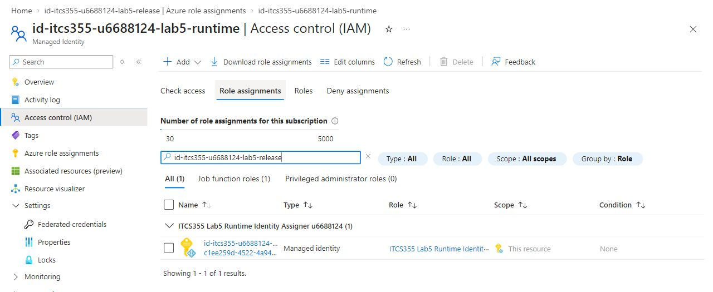

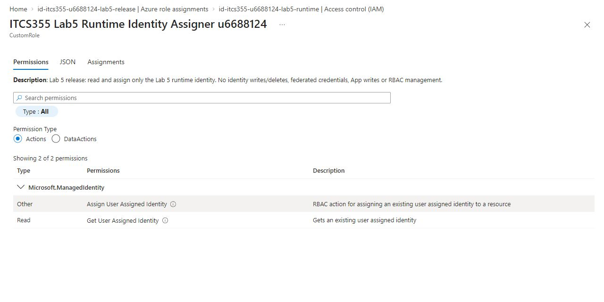

References: [Managed identity actions](https://learn.microsoft.com/en-us/azure/role-based-access-control/permissions/identity#microsoftmanagedidentity)
and [Managed Identity Operator](https://learn.microsoft.com/en-us/azure/role-based-access-control/built-in-roles/identity#managed-identity-operator).

### Staging placeholder — 2026-10-13

I created `lab5-staging` in the existing `feedbackpulse-env` in Malaysia West.
This gives the next release-role assignment an exact App scope. It uses
Microsoft's public Hello World image, not our model-serving image:

```text
mcr.microsoft.com/k8se/quickstart@sha256:3a4d93c34c6753f24765ab17a36f1754aee9b02082b7d9553d17697b9e8252c4
```

Ingress is disabled. The Consumption settings are 0.5 CPU, 1 GiB memory, and
0–1 replicas. No identity, secret, or private registry configuration is attached.

**Checks:** One create request succeeded. At 14:48 ICT, Azure reported
`Succeeded` and listed `lab5-staging--sw3yomt` as the latest ready revision.
Read-back confirmed the image, scale limits, disabled ingress, Lab 5 tags,
and exact Environment. The shared Environment configuration was unchanged.
The Portal later showed the revision running with one replica; this is not
proof that it had already scaled to zero or that running it costs nothing.

No roles were added, no compute or pipeline job was created, and no model was
registered or deployed. At this bootstrap step, release still needed App-scoped access. Model loading
and HTTP checks remain for the real pipeline deployment. No implementation code
changed, so the earlier offline tests were not rerun. Nothing was committed or pushed.

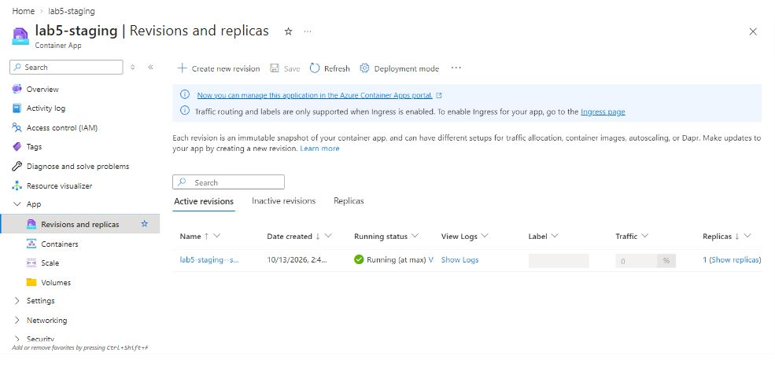

Image source: [Microsoft Container Apps quickstart](https://learn.microsoft.com/en-us/azure/container-apps/get-started?tabs=bash).

### Release App-scoped deployment role — 2026-10-13

I added `ITCS355 Lab5 Staging Deployer u6688124` to
`id-itcs355-u6688124-lab5-release`. Both the role's assignable scope and its
assignment are limited to `lab5-staging`, not the resource group or other Apps.

The role contains only the three actions used by the staging code:

- `Microsoft.App/containerApps/read` to check the App and deployment status.
- `Microsoft.App/containerApps/write` to update the App.
- `Microsoft.App/containerApps/revisions/read` to check the resulting revision.

There are no wildcards, data actions, App delete, secret-list, or role-management
permissions. App write is still a powerful permission: it can change that App's
image and configuration, not just the image tag. The release identity must stay
trusted, especially when the runtime identity is attached later.

**Checks at 15:03 ICT:** Direct read-back and the App-scoped assignment list
confirmed the release principal, exact scope, and three actions. The Portal
also showed the assignment at **This resource**. The earlier subscription-wide
listing still omitted the new assignment, while all ten earlier assignments
matched the baseline. I did not repeat the writes to address that listing delay.
The saved App and shared Environment configurations were unchanged.

This checks the saved permissions, not deployment by the release identity.
No identity was attached, no model was deployed, and no compute or pipeline job
was created. The placeholder still had one replica at the final check; I have
not verified scale-to-zero. No implementation code changed, tests were not rerun,
and nothing was committed or pushed.

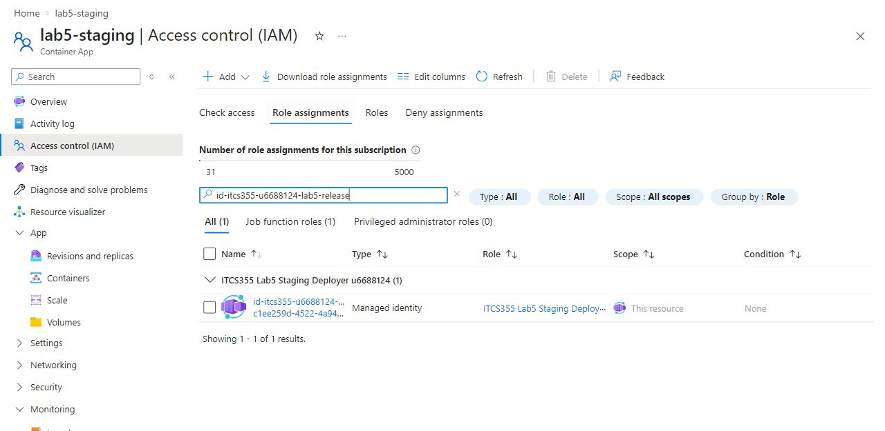

Reference: [Container Apps permissions](https://learn.microsoft.com/en-us/azure/role-based-access-control/permissions/compute#microsoftapp).

### Pipeline compute created — 2026-10-13

I created `cpu-lab5` from the reviewed draft in Malaysia West. Before creation,
Azure ML listed `Standard_F2s_v2` as supported: 2 vCPUs and 4 GiB memory. Both
the regional Dedicated quota and FSv2 Dedicated quota showed 0 of 16 vCPUs used,
so the one-node plan fit the quota. This does not guarantee capacity for a later job.

**Checks at 15:12 ICT:** Azure reported `Succeeded`, allocation state `Steady`,
and current/target node counts of **0/0**. Read-back matched Dedicated F2s_v2,
minimum 0, maximum 1, and 120 idle seconds before scale-down. Public SSH and
local authentication were disabled; public-node networking stayed as planned.
Only the training and release identities were attached. Runtime was not attached.
The Studio screenshots also show zero current nodes and the saved settings.

**Small check issue:** The quota response used the same family name for Dedicated
and Low-priority rows. My first guard stopped before sending a create request.
Filtering by Dedicated quota type fixed the check; I then sent one create request.

No pipeline, training job, or model deployment was started. No role assignments,
App settings, or shared Environment settings were changed. The compute file and
implementation code were unchanged, so the earlier offline tests were not rerun.
Image pulls, job identity selection, and datastore access still need a real
pipeline check. Sharing a cluster still assumes trusted code, as explained above.
Nothing was committed or pushed.

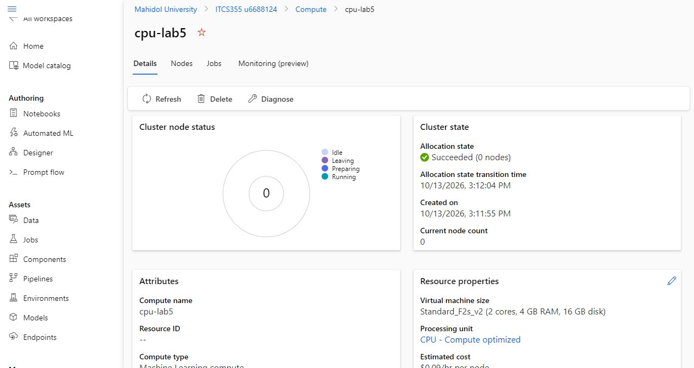

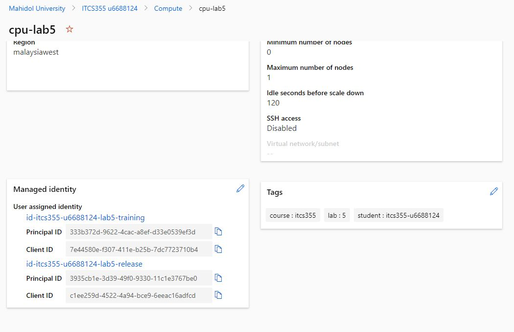

Reference: [Azure ML compute clusters and scaling](https://learn.microsoft.com/en-us/azure/machine-learning/how-to-create-attach-compute-cluster?view=azureml-api-2).

### Local staging settings ready — 2026-10-13

I prepared `cloud.env` with the workspace's tracking URI, the Lab 5 runtime
identity, and the approved current public IPv4 restricted to `/32`. The file
has owner-only permissions and is excluded from Git and Docker builds. The IP
must be checked again if the internet connection or address changes.

The serving configuration reuses this existing Lab 4 image:

```text
itcs355u6688124.azurecr.io/itcs355-lab4@sha256:654ed915ca7c12f59b619979f3795c705b82eb2a9ee23620b520e185095c6bb8
```

ACR confirmed that digest is readable and uses `linux/amd64`. The local serving
code and dependency lock have no differences from its source commit `83b1d62`.
The existing ACR ARM-token authentication policy is enabled; no registry settings
were changed. This does not prove the runtime identity can download the model.

**Checks:** The real local settings passed the existing validator with networking
blocked. The 23 configuration and image-recipe tests passed. No implementation
code changed, so I did not repeat the full suite.

The pipeline image is separate from this serving image. Its earlier local build
does not contain the latest storage and registration changes. The updated source
is saved in commit `c58490cc91d9ec8de9b52651e9ef2fc63e510f61`. The rebuild below
uses the following documentation commit, which has the same implementation code.
The ACR push recorded below supplies the manifest digest for final job compilation.

**Before committing:** The 189 focused storage, compute, pipeline, registration,
and training tests passed, with 1,237 existing dependency warnings. Ruff and
`git diff --check` passed too. I then updated the stale compute comments without
changing any configuration values; its three tests passed again.
No image build/push, pipeline run, deployment, or Git push was performed.

### Updated pipeline image — local checks, 2026-10-13

I built `itcs355-lab5:pipeline-4bec26f` for `linux/amd64` from commit
`4bec26f1a3e52886da8a74e3a1f34d1bff9e8277`. The build used a Git archive, so
local settings and uncommitted files were not build inputs. From the repository root:

```bash
set -o pipefail
git archive 4bec26f1a3e52886da8a74e3a1f34d1bff9e8277:lab/lab5 | \
  docker buildx build --platform linux/amd64 \
    --build-arg GIT_COMMIT=4bec26f1a3e52886da8a74e3a1f34d1bff9e8277 \
    --tag itcs355-lab5:pipeline-4bec26f --load --progress=plain -
```

The local image ID is
`sha256:6a8d4ca188e458244313031a33732a4b5953d491916c969c8aff3b5769241b8d`.
This is not an ACR manifest digest. The revision label matched the source commit,
and all 14 files in `src/`, `cloudlayer/`, and `scripts/` had matching SHA-256 hashes.
This image includes the new storage bindings. Dependency layers came from cache,
so this build did not test downloading every package again.

**Checks inside the image:** `pip check` passed. All six step commands accepted
`--help` from `/tmp`. The default user was `runner` (UID 10001), and it could write
to temporary output storage. The full suite passed: **438 tests in 17.60 seconds**,
with 1,237 existing dependency warnings. Tests and nonsecret fixture files were
mounted read-only; the implementation code came from the image, not a host mount.

Both checks used disabled networking, a read-only root filesystem, and no mounted
credentials. They did not submit a pipeline or call Azure. Local checks passed,
but Azure image pulls, managed-identity access, job output storage, and staging
model loading still need a real run. No image or Git push was performed during
that local check; the later image push is recorded below.

### Pipeline image in ACR — 2026-10-13

I pushed the tested image to `itcs355u6688124.azurecr.io/itcs355-lab5:pipeline-4bec26f`.
The tag did not exist before the push, and I did not rebuild or overwrite an old
image. Use this fixed reference for the pipeline:

```text
itcs355u6688124.azurecr.io/itcs355-lab5@sha256:564040abcebe0fa9d0ff1702d1d5ec52e367657bc72ef78f762fcc72327e3e49
```

**Checks:** The push result, Docker repository digest, and ACR metadata matched.
The remote manifest's config digest matched the tested local image ID
`sha256:6a8d4ca188e458244313031a33732a4b5953d491916c969c8aff3b5769241b8d`.
ACR and the Portal both showed `linux/amd64` and the expected tag.
The 438-test result above still applies to this exact image; I did not repeat it.

I used the signed-in user's existing access, with temporary Docker login storage
removed afterward. No roles or registry settings changed. Admin credentials and
anonymous pulls stayed disabled. This proves the image was published, not that
the training identity can pull it yet. No pipeline or deployment was started,
and no Git commit or push was made. The local compilation with this digest is
recorded below.

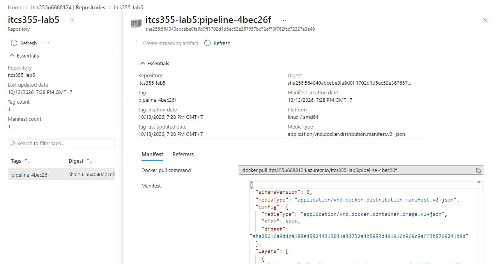

### Job YAML with real settings — local check, 2026-10-13

I used the existing compiler to create a job YAML with the published pipeline
image above, source commit `4bec26f`, the 6,000-row CSV, and its DVC metadata.
The implementation and pipeline files still matched that commit. No rebuild
or code change was needed.

**Checks:** The installed Azure ML SDK loaded the saved YAML successfully.
All six steps use `cpu-lab5` and the same pipeline image. The first five use
the training identity; only `deploy_staging` uses release. Inputs go to
`lab5_inputs`, and outputs use `lab5_artifacts`. The validation ROC-AUC floor
is `0.80`. Registration depends on the gate report, and deployment takes the
model version from registration, with `lab5-staging` as its only App target.

The check blocked network, credential, and subprocess calls during compilation
and reload; none were attempted. The input files and `cloud.env` were unchanged.
There were 611 dependency warnings and SDK experimental-schema notices. I did
not rerun the full test suite because no implementation changed.

The YAML is in a private temporary directory outside Git, with directory mode
`0700` and file mode `0600`, because it contains the allowed IP and local paths.
Recompile if it is removed or the approved settings change. Nothing was uploaded,
submitted, trained, or deployed, and no Git commit or push was made. Task 1 is
still in progress: the next live run needs separate approval and must verify
image pulls, storage access, registration, and staging model loading.

### First live-run preflight — stopped before submission, 2026-10-13

The approved run stopped at the local IP check. Two independent IP services
returned the same current public IPv4, but it differed from the `/32` saved in
both `cloud.env` and the compiled YAML. I did not submit the job or change access
rules. No Azure call was made during this attempt. Before running, confirm the
new allowed IP, update the local settings, and recompile; do not widen access
to work around the mismatch.

### First managed pipeline run — 2026-10-13

After approval, I updated only the allowed IP to the current `/32` and recompiled
the private job YAML. The same image and source commit were used. Azure accepted
one job: `lab5-normal-4bec26f-20261013-01`.

**Result:** Ingest, validate, train, and evaluate passed. The 6,000-row data hash
matched the local input. Validation ROC-AUC was **0.844499**, and test ROC-AUC was
**0.846673**. The gate passed at `0.80`, and its training-record hash matched the
actual metrics file. These are results from Azure, not another local training run.

**Obstacle:** Registration uploaded the model files, but Azure rejected the model
version request. The Activity Log at 13:01:06 UTC says the training identity lacks
`Microsoft.MachineLearningServices/workspaces/models/write`. The existing version
write permission was not enough. I checked the registry before considering any
retry; no Lab 5 model version was found. I did not add permissions or resubmit.

Deployment never started. At 13:10 UTC, `lab5-staging` still used its original
placeholder image and revision, with ingress disabled. `cpu-lab5` was `Steady`
with current/target node counts of **0/0**. This is not a zero-cost claim; billing
has not been collected, and the existing App and shared resources remain.

The small [run record](reports/lab5-first-pipeline-run.json) contains the step
IDs, metrics, gate result, and registration error. Logs stayed in a private
temporary folder; no model files or IP were added to Git. The SDK's training
output download returned no files, so I read the recorded JSON files directly
from `lab5-artifacts` instead. No implementation code, roles, Git commits, or
Git pushes changed during that run. I stopped for approval before the permission
fix recorded below.

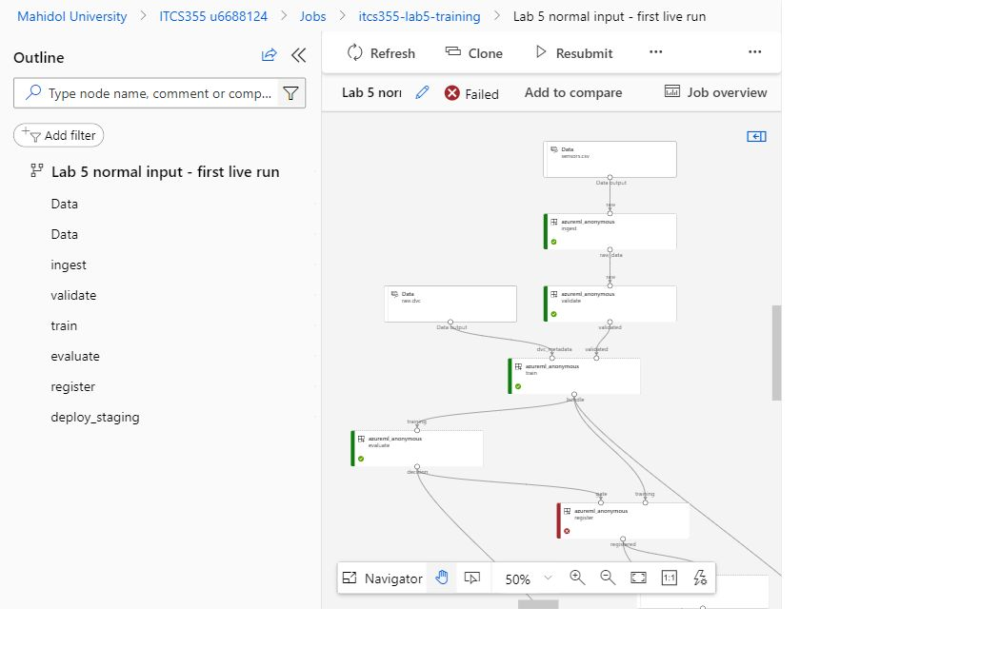

### Registration permission fix — 2026-10-13

The first run showed that writing a model version also needs permission to write
the model entry. After approval, I added only
`Microsoft.MachineLearningServices/workspaces/models/write` to the existing
`ITCS355 Lab5 Model Registrar u6688124` role.

**Checks at 13:22 UTC:** Azure accepted the update. A separate read-back showed
six actions: the original five plus this one. The other role fields and the
existing assignment were unchanged. This role is still assigned only to the Lab 5
training identity at `mlw-itcs355-u6688124`; runtime and release received nothing
from this update. There are still no wildcard, delete, secret-read, deployment,
or role-management actions in this role.

These permissions cover models across that workspace, not only the Lab 5 model.
This confirms the saved role, not successful registration by a running job.
No pipeline retry, model registration, deployment, build, commit, or push was
started in this step. No implementation code changed, so I did not rerun the
offline tests. The approved retry with the same image, code, data, and gate is
recorded below.

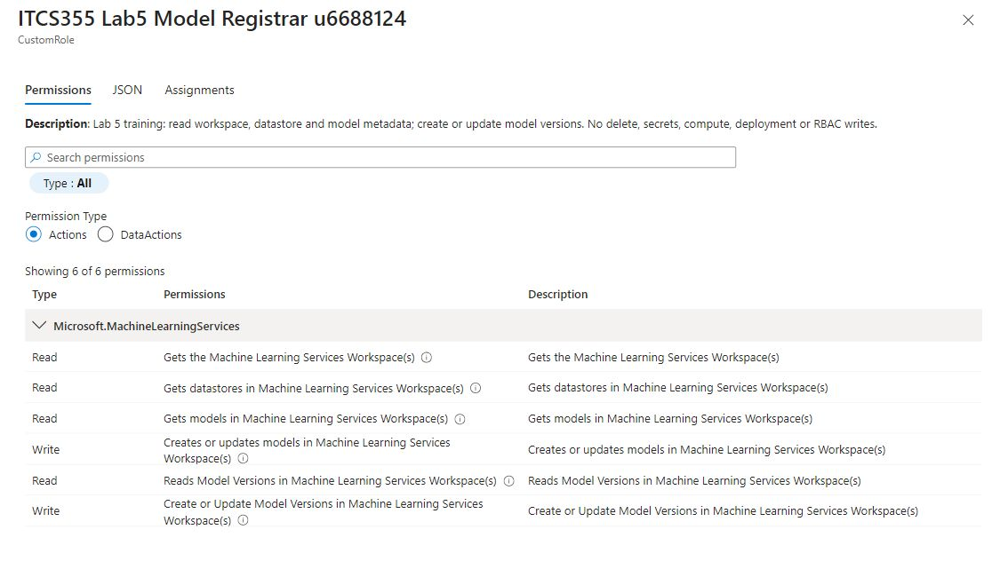

### Managed pipeline retry — 2026-10-13

I ran `lab5-normal-4bec26f-20261013-02` once after the permission fix.
Ingest, validate, train, and evaluate passed again. Validation ROC-AUC was
**0.844499**, and test ROC-AUC was **0.846673**, the same as the first run.
The gate passed at `0.80`, and its hash matched this run's actual metrics file.

**Obstacle:** Registration uploaded the model files but failed again. The Activity
Log at 13:37:54 UTC now names
`Microsoft.MachineLearningServices/workspaces/metadata/artifacts/write`, not the
earlier `models/write` action. The saved role was still too narrow for this
registration request. This action allows creating or updating workspace artifacts
([Azure permission reference](https://learn.microsoft.com/en-us/azure/role-based-access-control/permissions/ai-machine-learning#microsoftmachinelearningservices)).
I stopped without adding it or starting a third run.

At 13:41 UTC, the registry still had no Lab 5 model version. Deployment did not
start, and staging still used the placeholder with ingress disabled. At 13:44 UTC,
compute had returned to **0 current / 0 target nodes**. This does not mean the
whole setup costs nothing; the App and shared resources remain.

The [retry record](reports/lab5-pipeline-retry.json) contains the step IDs, scores,
gate hash, and exact missing permission. Raw logs stayed outside Git. No code,
roles, images, or Git history changed in this retry step. Registration, staging
model loading, and the negative managed runs are still unverified.

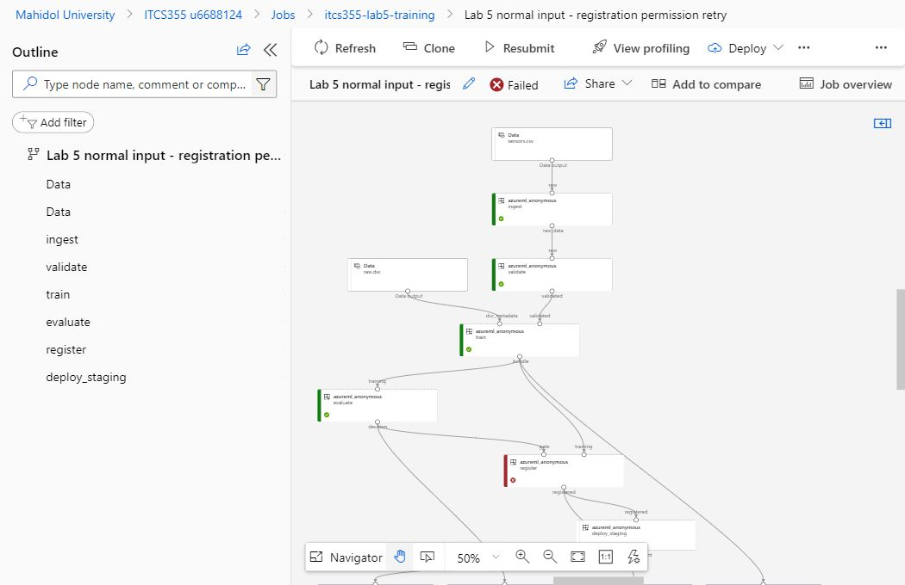

### Artifact permission fix — 2026-10-14

After approval, I added only
`Microsoft.MachineLearningServices/workspaces/metadata/artifacts/write` to
`ITCS355 Lab5 Model Registrar u6688124`. The role went from six to seven actions.

**Checks at 05:28 UTC:** A separate read-back matched the one-action change.
The description, other permissions, and assignable scope stayed the same.
The role still had one assignment: the Lab 5 training identity on
`mlw-itcs355-u6688124`. Runtime and release received no new access. This action
covers artifacts across that workspace, not only the Lab 5 model. No wildcard,
delete, secret-read, deployment, or role-management action was added.

The first immediate read-back did not match yet. I made no second write; a later
read-back matched, and refreshing Azure Portal showed all seven permissions.
The screenshots below leave out the account header.

This confirms the saved permissions, not successful registration. I did not run
register or a pipeline, change the implementation, build an image, deploy,
commit, or push. Offline tests were not rerun for this permission-only change.

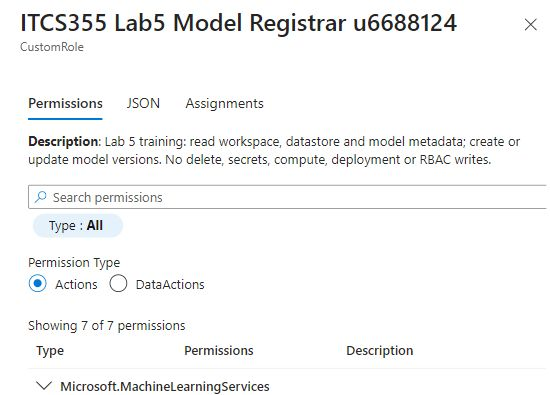

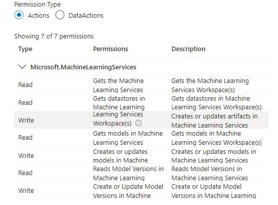

### Registration-only check — 2026-10-14

I ran `lab5-register-only-4bec26f-20261014-01` once using the image and training
identity from the latest pipeline. It reused that run's model and `gate.json`;
I did not train again or run the other pipeline steps. Before submission, the
gate matched the training metrics, and all five model files matched their hashes.

**Result:** The job failed. The Activity Log at 05:45:29 UTC says the training
identity lacks `Microsoft.MachineLearningServices/workspaces/metadata/artifacts/read`.
The role already had artifact-write permission, but that did not cover this read.
I did not add permissions or retry.

**Important:** Azure still saved `itcs355-u6688124-lab5:1`. Its tags matched the
source run, and all five files matched the original training output. However,
the output folder was empty and no `registration.json` was written. A model entry
existing is not the same as this step finishing successfully. I have not verified
loading this version through the runtime, and rerunning blindly could create
another version.

At 05:50 UTC, compute was back to **0 current / 0 target nodes**. Staging was
unchanged: the original placeholder revision with ingress disabled. No code,
roles, images, deployment, commit, or push changed. Offline tests were not rerun
because this check did not change the implementation.

The [registration-only record](reports/lab5-register-only.json) contains the
source artifacts, hashes, exact error, and read-back results. Raw logs stayed
outside Git. The next step needs review of the missing read permission and the
existing version before any further registration attempt.

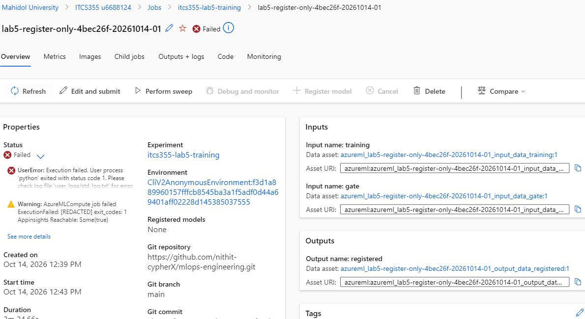


### Artifact-read permission fix — 2026-10-14

After approval, I added only
`Microsoft.MachineLearningServices/workspaces/metadata/artifacts/read` to the
existing `ITCS355 Lab5 Model Registrar u6688124` role, taking it from seven to
eight actions. At 06:02 UTC, a separate read-back confirmed the exact change.
All other role fields and the single assignment stayed unchanged: the Lab 5
training identity on `mlw-itcs355-u6688124`. Runtime and release received nothing.
This allows reading artifacts across that workspace, not only model version 1.
No wildcard, delete, secret-read, deployment, or role-management action was added.

Azure accepted one update. Portal initially showed the old seven permissions;
after a full page reload, it showed all eight. I did not repeat the write.
The screenshot leaves out the account header.

This checks the saved role, not successful registration by the training identity.
Version 1 was not changed, deleted, or archived. No register job, full pipeline,
training, build, deployment, commit, or push was started. No implementation changed,
so offline tests were not rerun. I stopped here for review before another job.

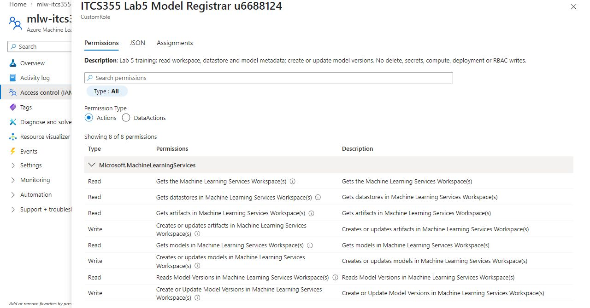

### Registration-only retry — 2026-10-14

I ran `lab5-register-only-4bec26f-20261014-02` once after the permission fix.
It used the same image, training identity, model files, and `gate.json` as the
previous check. I did not train again or run the full pipeline.

**Result:** The job completed and wrote `registration.json` for
`itcs355-u6688124-lab5:2`. At 06:12 UTC, a separate registry read-back matched
that name and version. The tags matched the source run, and all five model files
matched their original SHA-256 hashes. Version 1 was not changed, deleted, or
archived. Version 2 contains the same trained model; it does not mean a better
model or a new training result. Both versions reference the same model-file path.

At 06:20 UTC, compute was back to **0 current / 0 target nodes**. Staging was
unchanged, with the placeholder revision and ingress disabled. No implementation,
roles, images, deployment, commit, or push changed in this retry. Offline tests
were not rerun because no implementation changed. Zero compute nodes does not
remove storage or other shared-resource costs.

The [retry result](reports/lab5-register-only-retry.json) records the inputs,
image digest, gate, file hashes, registration output, and checks. This proves
registration by the training identity, not runtime loading or deployment.
Task 1 is still in progress.

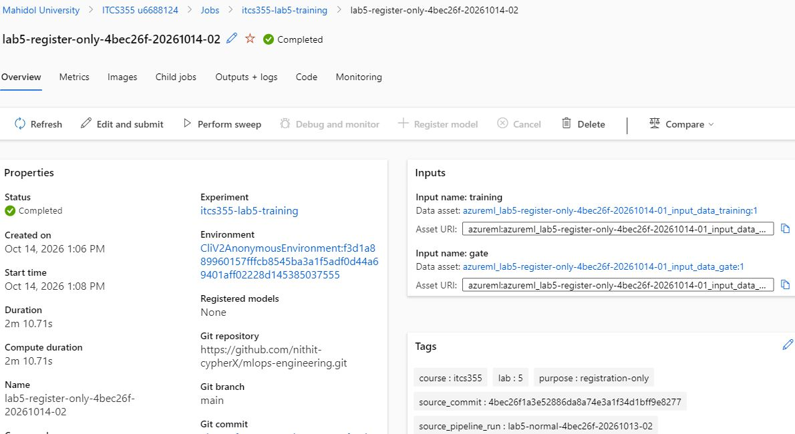

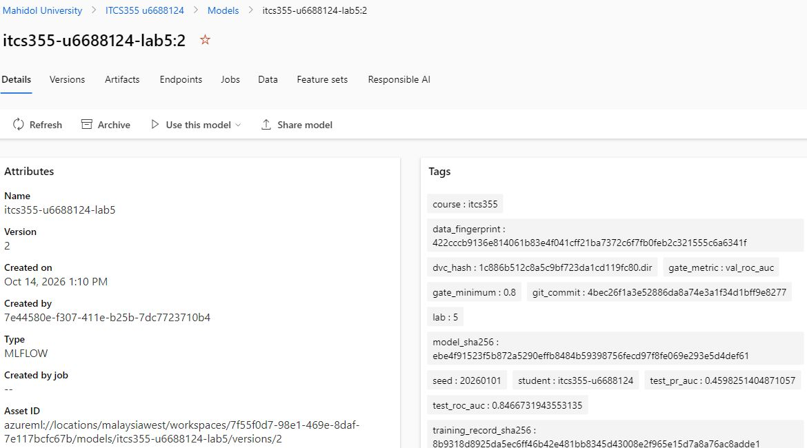

### Staging preflight — 2026-10-14

I checked the existing staging path without deploying. The registration output
passed the staging reader and matched model version 2 in the registry. The
configuration uses the reviewed digest-pinned Lab 4 serving image and the same
workspace tracking URI. All **61 offline staging tests passed**; their network
and credential calls are mocked. No implementation changed.

At 06:30 UTC, the shared environment and `lab5-staging` were still `Succeeded`.
The App still used its placeholder image, with ingress disabled and no runtime
identity attached. Release was attached to compute and its existing scoped role
assignments were present. Runtime still had model-metadata read, Blob Reader on
`lab5-artifacts`, and `AcrPull` on the registry. These saved grants do not yet
prove that the runtime's MLflow download will work.

**Before deployment:** The configured `/32` IP no longer matches the current
internet connection. It needs review and an update before testing the endpoint;
neither address is recorded here. Compute stayed at zero nodes. I did not update
configuration or roles, submit a job, deploy, build, commit, or push. The next
proposed check is one deploy-only job using version 2, followed by HTTP checks,
without training or registering again. This still would not prove the full
pipeline in one execution.

### Local staging IP update — 2026-10-14

After approval, I changed only `SERVING_ALLOWED_IP` in the Git-ignored `cloud.env`
to the current connection's public IPv4 address with `/32`. At 06:33 UTC, the
actual config loader and staging validation passed with that value. A comparison
confirmed that all other file contents were unchanged. The file remained ignored
and untracked, and no IP value was copied into this README.

This was a local configuration change only. I did not update an existing job,
submit a new job, change Azure access rules or roles, deploy, commit, or push.
The next deploy-only job must read the updated configuration rather than reuse
an earlier job's IP setting. Runtime model loading is still unverified.

### Deploy-only check — 2026-10-14

I submitted `lab5-deploy-only-4bec26f-20261014-01` once using model version 2,
the existing pipeline image, and the release identity. The current IP matched
the local configuration before submission. No training or registration was run.

**Result:** Azure ML could not pull the pipeline image from ACR. Studio showed
`AggregatedUnauthorizedAccessError`. The deployment command did not start, and
no `deployment.json` was produced. Staging kept its placeholder revision with
ingress disabled, so I did not run `/health`, `/ready`, or `/predict`.

**What I found:** The job selects release, which has no ACR role. Training has
`AcrPull` and completed the previous job with the same image. This points to an
image-pull permission gap, but the error does not name the identity used for the
failed pull. My earlier assumption that training's grant was enough for the
release job is still unverified. I stopped without adding a role, enabling the
ACR admin user, or retrying.

At 07:14 UTC, compute was back to **0 current / 0 target nodes**. Model versions
1 and 2 stayed in place. The existing App and shared resources remain, so this
does not mean all cloud costs stopped. No implementation, commit, or push changed;
offline tests were not rerun. Runtime loading and Task 1 are still unverified.
The [result record](reports/lab5-deploy-only.json) includes the inputs, image
digests, read-back checks, and the permission hypothesis separately from facts.

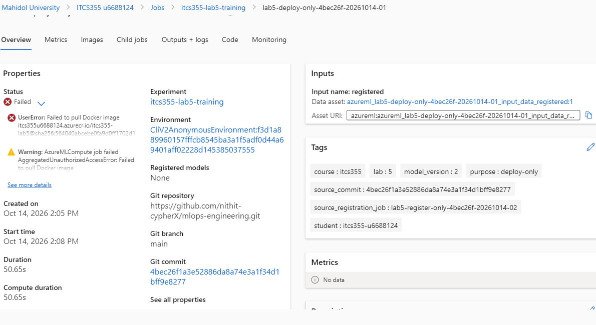

### Release image access and deploy-only retry — 2026-10-14

After approval, I added `AcrPull` to the Lab 5 release identity at the existing
ACR scope. This allows image pulls across that registry, not just one repository;
it does not allow image pushes. The assignment read-back matched, and ACR admin
stayed disabled. I also updated only `SERVING_ALLOWED_IP` in the ignored
`cloud.env` after the current IP changed again. No IP value is recorded here.

I submitted `lab5-deploy-only-4bec26f-20261014-02` once, using the same pipeline
image and registered model version 2. This time the deployment command ran and
created revision `lab5-staging--0000001`. The App pulled the pinned serving image
and started the API. No training, registration, or image build was repeated.

**Problem:** The runtime log reported HTTP 403 because its identity lacks
`Microsoft.MachineLearningServices/workspaces/metadata/artifacts/read`. I matched
the identity in that error to the Lab 5 runtime identity and checked its current
three-action model-reader role. Without the model, `/ready` returned 503, the
startup probe failed, and the revision reached `ActivationFailed`. The Azure ML
job then ended with `MaxWallClockTimeExpired`; Studio showed **10m 56.91s**.
That duration is not a billing calculation. Increasing the timeout alone would
not resolve the observed permission denial.

No `deployment.json` was produced, and I did not send external `/health`, `/ready`,
or `/predict` requests. The 503 responses above came from Azure's probes.
At 13:36 UTC, compute was back to **0 current / 0 target nodes** and both App
revisions had zero replicas. The failed revision still had 100% of the traffic
configuration; this is not a working endpoint or a completed rollback. HTTPS
and the single approved `/32` allow rule were checked. Shared resources remain,
so zero replicas and compute nodes do not mean zero cloud cost.

I stopped without another role change or job retry. Model versions 1 and 2
remain. No implementation, commit, or push changed, and offline tests were not
rerun for this evidence update. The next proposed fix is to review the missing
read action in the runtime's existing workspace-scoped role before another
approved deploy-only check. Task 1 is still in progress. The
[retry record](reports/lab5-deploy-only-retry.json) contains the inputs and checks.

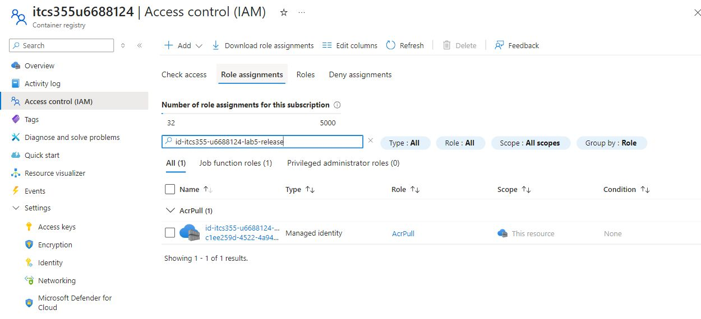

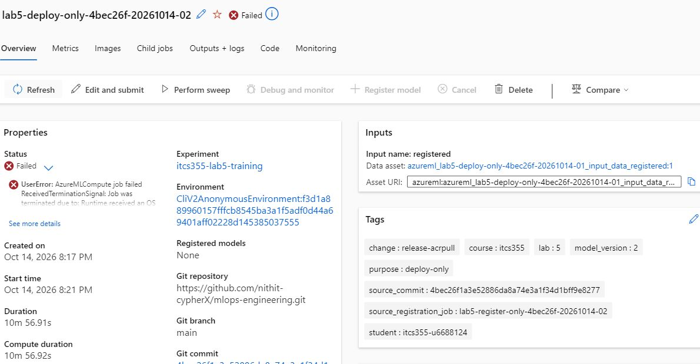

### Runtime read permission and one restart — 2026-10-14

After approval, I added only
`Microsoft.MachineLearningServices/workspaces/metadata/artifacts/read` to the
existing runtime model-reader role. It now has four actions. The workspace
scope and runtime assignment stayed the same; this permission covers artifact
metadata across that workspace, not just model version 2. I also refreshed only
the approved `/32` IP in the ignored `cloud.env` after the connection changed.

I ran `lab5-deploy-only-4bec26f-20261014-03` once with the same images and model
version 2. The App update succeeded, but it reused `lab5-staging--0000001`;
there was no new revision. With separate approval, I restarted that revision
once. Activity Log confirmed `Succeeded` at **13:51:20 UTC**, but the revision
stayed `ActivationFailed` with zero replicas. A successful restart request is
not the same as a working API. No new model-loading logs appeared in the query
for this revision after 13:50 UTC, so this attempt does not prove whether its
MLflow download works with the new permission.

**Result:** The job failed with `MaxWallClockTimeExpired` and wrote no
`deployment.json`. Studio showed **11m 6.278s**, not a billing calculation.
The external `/health` check returned 200 with a non-JSON body, and `/ready`
returned 404. Neither response passed the API contract. I did not send `/predict`.
This attempt also included an operator restart, so it is not evidence of a
fully automated pipeline.

At **14:03 UTC**, compute was back to **0 current / 0 target nodes**. The model
revision still had 100% of the traffic configuration and zero replicas; the
older placeholder was healthy with one replica and 0% configured traffic.
At **14:06 UTC**, the placeholder also scaled to zero, so both App revisions
had zero replicas. The model revision still showed `ActivationFailed`.
Zero nodes and replicas do not mean all shared-resource costs stopped.
Model versions 1 and 2, HTTPS, the single approved IP rule, and disabled ACR
admin access were unchanged.

I stopped after the one approved job and restart. No new revision, training,
registration, image build, implementation change, commit, or push was made.
Offline tests were not rerun because the implementation did not change. The
[result record](reports/lab5-runtime-read-retry.json) separates the saved
permission and successful restart operation from the still-failed runtime.
Task 1 remains in progress; another recovery action needs review first.

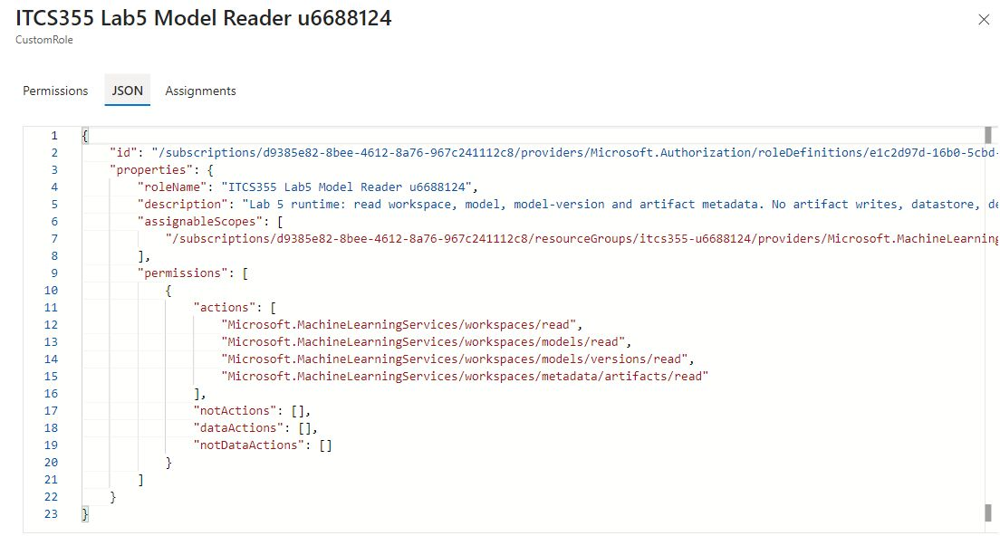

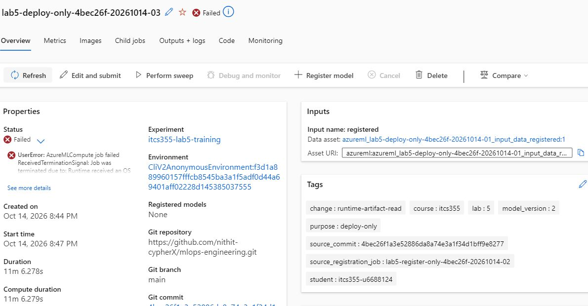

### New revision recovery — 2026-10-14

After approval, I created `lab5-staging--model2-readfix-1014` by changing only
the revision suffix. The image digest, model version 2, runtime identity,
ingress rules, and 0–1 replica setting stayed the same. No role was added or
changed. This uses Azure's [revision-scope update](https://learn.microsoft.com/en-us/azure/container-apps/revisions#revision-scope-changes),
not a new training run or image build.

**Result:** The new revision logged `model loaded` for version 2 and became
healthy. It received 100% of traffic, while the two older revisions became
inactive. At **21:12 Thailand time (14:12 UTC)**, `/health` and `/ready` returned
200 with the expected JSON and version header. One synthetic `/predict`
request also returned 200, version `2`, and probability **0.0073735752**.
This checks that serving works; it is not a new accuracy or latency benchmark.

The [recovery record](reports/lab5-new-revision-recovery.json) contains the
exact request, response, image digest, and read-back checks. Compute stayed at
**0 current / 0 target nodes**. The App had one healthy replica at the 14:15 UTC
check and still uses automatic scaling from zero to one; shared-resource costs
remain. I did not stop or delete the App.

This was a direct operator recovery, not an Azure ML job. The earlier failed
job results are unchanged, and this does not produce a successful pipeline
`deployment.json`. Task 1 still needs end-to-end and managed negative-path
verification. No training, registration, build, permission change, implementation
change, commit, or push was made in this step. Offline tests were not rerun;
the checks here were against the live revision and API.

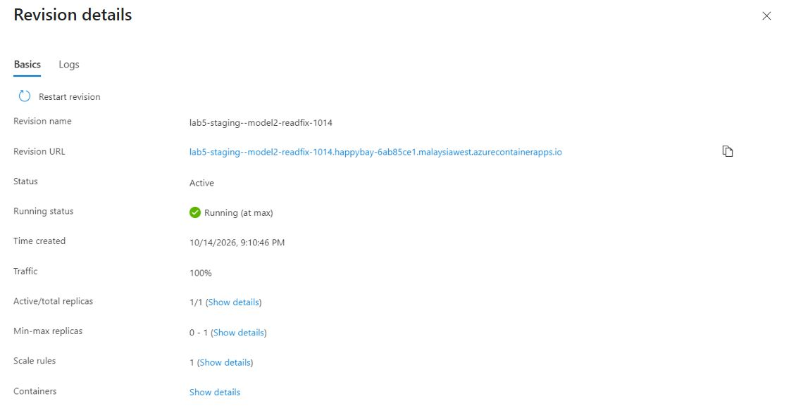

### Revision-state checks — 2026-10-15

The recovered revision reported `RunningAtMaxScale` with `Healthy`, but the
adapter did not recognise that running state. I added it to the accepted states,
still requiring `Healthy` and the existing image, model, identity, access, and
traffic checks. `ActivationFailed` now stops the check as a failure instead of
waiting for the timeout. It does not restart, delete, or redeploy the revision.
This fixes status handling; it does not fix a model-loading permission problem.

**Checks:** Before the fix, two regression cases failed: a healthy
`RunningAtMaxScale` revision timed out, and `ActivationFailed` kept waiting.
After the fix, all **75 offline staging tests** and Ruff passed. The tests also
check that max-scale revisions without `Healthy`, or with the wrong image,
model, identity, access, or traffic, do not pass. A failed activation returns
exit code 1 without another poll or a success `deployment.json`.

Run these focused checks from `lab/lab5/`, using the existing Lab 2 environment:

```bash
PYTHONDONTWRITEBYTECODE=1 PYTEST_DISABLE_PLUGIN_AUTOLOAD=1 \
  ../lab2/.venv/bin/python -m pytest -q -p no:cacheprovider cloudlayer/tests/test_staging.py

PYTHONDONTWRITEBYTECODE=1 \
  ../lab2/.venv/bin/python -m ruff check --no-cache \
  --config ../lab4/ruff.toml cloudlayer/azure_staging.py cloudlayer/tests/test_staging.py
```

These checks used mocked Azure responses and a fake clock. No Azure calls,
training, image build, commit, or push were made. The pipeline image in ACR
still contains the older adapter, so this local fix has not been tested in a
managed job. The earlier live results are unchanged, and Task 1 is still in
progress.

### Updated adapter in the local pipeline image — 2026-10-15

I committed only the adapter and its tests as
`4dfb85dd9ac43f7502f173cf7a6f7db0fd9e4b65`, then built
`itcs355-lab5:pipeline-4dfb85d` for `linux/amd64`. The build used a Git archive
of that commit, not the working folder. The Dockerfile and dependency lock
stayed the same, and dependency layers came from cache.

From the repository root:

```bash
set -o pipefail
git archive 4dfb85dd9ac43f7502f173cf7a6f7db0fd9e4b65:lab/lab5 | \
  docker buildx build --platform linux/amd64 \
    --build-arg GIT_COMMIT=4dfb85dd9ac43f7502f173cf7a6f7db0fd9e4b65 \
    --tag itcs355-lab5:pipeline-4dfb85d --load --progress=plain -
```

The local image ID is
`sha256:38539f80776bad57436ace5a5d4b32af9961cd40e7b81a816567a5d0ca3dad7d`.
This is not an ACR manifest digest. The revision label matched the commit,
and SHA-256 hashes matched for all 14 implementation files in `src/`,
`cloudlayer/`, and `scripts/`.

**Checks inside the image:** All **452 tests passed in 15.82 seconds**, including
the 75 staging tests. The suite reported 1,237 warnings from the existing
dependencies, not test failures. Tests and nonsecret fixture files from the same
commit were mounted read-only: `tests/`, `pipeline/`, `Dockerfile`, `.dockerignore`,
the two requirements files, and `cloud.env.example`. No implementation folder
was mounted, so the tests used the code built into the image.

The container ran with `--network none`, a read-only root filesystem, and
temporary `/tmp` storage. No credentials were mounted. Training tests used
small synthetic data and temporary models, not a new run on the lab dataset.
`pip check` passed, the updated staging command accepted `--help`, and the
default user was `runner` (UID 10001) with writable temporary storage. Pip also
reported that its cache was disabled because the filesystem was read-only.

This step built and checked the image locally only. No image or Git push,
Azure job, registration, deployment, or permission change was made. The serving
image is unchanged. The new pipeline image still needs an approved ACR push
and a deploy-only check; Task 1 remains in progress.

### Updated pipeline image in ACR — 2026-10-15

I pushed the tested image as
`itcs355u6688124.azurecr.io/itcs355-lab5:pipeline-4dfb85d`.
The tag did not exist before the push. I did not rebuild the image or overwrite
the older tag. The fixed image reference for the next job is:

```text
itcs355u6688124.azurecr.io/itcs355-lab5@sha256:f57a562fc602d0e2ed97db7d2770afb1c0dd5ba0ad91ca50346cb5c1e23f9be2
```

**Checks:** The push result, Docker repository digest, and ACR metadata matched.
The remote manifest showed `linux/amd64`. Its config digest matched the tested
local image ID `sha256:38539f80776bad57436ace5a5d4b32af9961cd40e7b81a816567a5d0ca3dad7d`.
The Portal showed the same tag, digest, and platform. The earlier 452-test result
applies to this exact image; I did not repeat the tests or change dependencies.

**Obstacle:** Azure CLI initially failed while loading the existing ML extension.
For these core ACR commands, I used an empty temporary extension directory through
`AZURE_EXTENSION_DIR`, with automatic extension installation disabled. I did not
delete, reinstall, or repair the ML extension. The push used the signed-in user's
existing access and temporary Docker login storage, which was logged out and
removed afterward. No role or registry setting changed; admin access and anonymous
pulls were disabled in preflight.

I also prepared a private deploy-only YAML using this digest, the existing
registration output for model version 2, `cpu-lab5`, and the release identity.
It keeps one compute instance and the existing 600-second job timeout. The SDK
saved and reloaded the standalone job, and checks confirmed its command, image,
identity, input/output paths, and settings. Network and credential operations
were blocked during that check. The draft stays outside Git with directory mode
`0700` and file mode `0600`; it contains the allowed IP, which still needs a fresh
preflight check before submission.

No Azure job, training, registration, deployment, new resource, permission change,
Git commit, or Git push was made. The serving image and current App were not
changed. Publishing the image is not proof that the managed deploy-only job has
passed. That check is the next step, and Task 1 is still in progress.

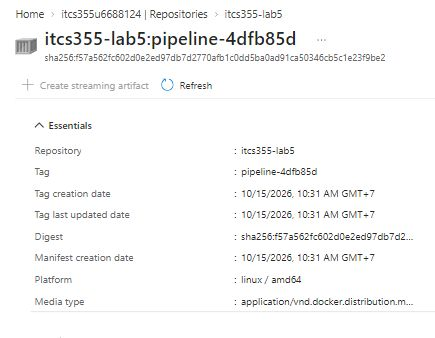

### Deploy-only preflight — 2026-10-15

I checked the private job draft before submitting it. It uses the new pipeline
image above, model version 2, the release identity, one `cpu-lab5` instance, and
the existing 600-second timeout. The registration file's SHA-256 still matched
the earlier result, and Azure ML returned the same model version.

The existing App was `Succeeded`, with revision
`lab5-staging--model2-readfix-1014` active at 100% traffic and scaled to zero.
The serving image, HTTPS-only setting, shared environment, and runtime identity
passed the checks. Compute still had the training and release identities and
the configured 0–1 instance limit. This was a configuration check, not a new
prediction test or a live check of the compute node count.

**Stopped before submission:** The current public IPv4 no longer matched the
single `/32` address in `cloud.env`, the private draft, and the App's allowlist.
Those three still agreed with each other, but allowed the older address.
Updating this access setting needs approval before the deploy-only job runs.
No IP value is included here. The planned job did not exist, and I did not
submit it, change Azure settings, or commit/push Git. Task 1 remains in progress.

### Updated adapter deploy-only result — 2026-10-15

After approval, I updated only `SERVING_ALLOWED_IP` in the ignored `cloud.env`
and private job draft to the current IPv4 `/32`. I checked both values, then
submitted `lab5-deploy-only-4dfb85d-20261015-01` once. It used the new pinned
pipeline image, release identity, `cpu-lab5`, model version 2, and the same
serving image. The job kept its 600-second limit and one compute instance.

**Result:** The job failed with `MaxWallClockTimeExpired`. Azure ML Studio
displayed a duration of 11m 2.760s; this is not a billed-time calculation.
No `deployment.json` was saved. The App update itself succeeded, and its
single allowed IP matched the updated configuration.

**What stopped it:** The existing revision was `Provisioned`, active at 100%
traffic, and `ScaledToZero` with zero replicas and health `Healthy`. Our adapter
only accepted scale-to-zero when health was empty or `None`, so it kept waiting.
The earlier tests covered the `None` case but missed this `Healthy` case.
Azure eventually terminated the job at its wall-clock limit. I did not wake
the App, restart it, retry the job, increase its timeout, or change the adapter.
There were no new HTTP smoke checks, so this is not a new API-readiness claim.

**Lineage note:** The SDK picked up the instructor checkout's Git metadata
because I launched the submission from that folder. Those automatic fields do
not identify the code in the image. The `source_commit` tag and verified image
digest identify `4dfb85d`; no local implementation code was uploaded. The next
submission should run from the student repository and check this metadata first.

I saved the [result and read-back](reports/lab5-deploy-only-updated-adapter.json)
and the screenshots below. At 04:14:55 UTC, compute was back to zero current
and target nodes. The App had zero replicas; shared resources remain and can
still have costs. No train/build, registration, permission change,
commit, or Git push was made. Task 1 was still in progress. At that checkpoint,
the next proposed fix was only the missing scale-to-zero case and a regression
test; it had not been implemented or run in Azure.

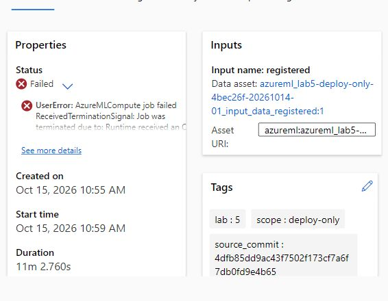

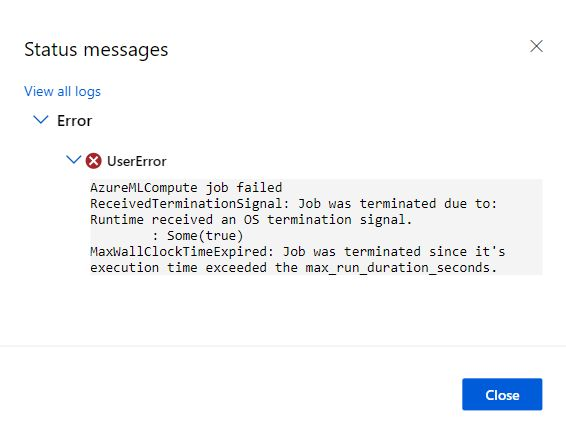

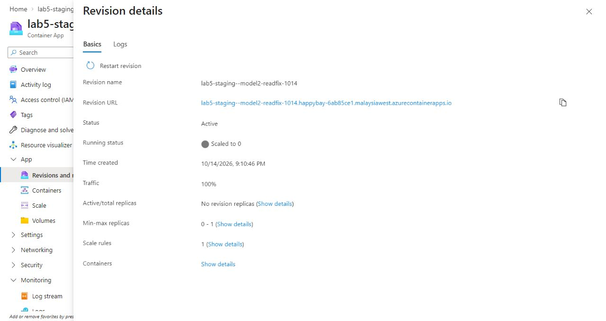

### Scale-to-zero health fix — local only, 2026-10-15

I changed one condition in [the adapter](cloudlayer/azure_staging.py):
`ScaledToZero` can now have health `Healthy`, as long as replicas are zero.
The earlier empty/`None` health cases still work. Image, model, ownership,
identity, traffic, and ingress checks are unchanged, as are the timeout and
single-write behavior. The result stays `revision_state: scaled_to_zero` with
`http_smoke_tested: false`; it does not claim that the API is ready to answer.

**Regression check:** Before the fix, the new `Healthy` case timed out both
through the adapter and the CLI: 2 tests failed and 3 passed in the focused
check. After the fix, all **91 staging tests passed** and Ruff passed for the
two changed code/test files. Tests also reject unhealthy/unknown health,
nonzero or missing replica counts, and wrong image/model/access settings.
The CLI test checks the saved `deployment.json`, including its scale-to-zero
state and the fact that no HTTP smoke test ran.

Run from `lab/lab5/`:

```bash
PYTHONDONTWRITEBYTECODE=1 PYTEST_DISABLE_PLUGIN_AUTOLOAD=1 \
  ../lab2/.venv/bin/python -m pytest -q -p no:cacheprovider cloudlayer/tests/test_staging.py

PYTHONDONTWRITEBYTECODE=1 \
  ../lab2/.venv/bin/python -m ruff check --no-cache \
  --config ../lab4/ruff.toml cloudlayer/azure_staging.py cloudlayer/tests/test_staging.py
```

These tests used mocked Azure responses and a fake clock, with real network
connections and default credentials blocked. At that initial local-fix checkpoint,
no Azure call, build, training, permission change, commit, or push was made.

### Scale-to-zero fix in the pipeline image — local only, 2026-10-15

I committed only the adapter and its tests as
`aa6a4cdea8da1529fa0f70de529b782ed80c0a46`, then built
`itcs355-lab5:pipeline-aa6a4cd` for `linux/amd64` from a Git archive of that
commit. The Dockerfile and dependency lock stayed the same. Uncommitted files
were not part of the build. The image runs as `runner`, and its Git SHA label
and `GIT_COMMIT` match the source commit.

All **91 staging tests passed inside the image** with `--network none`, a
read-only filesystem, and temporary storage in `/tmp`. Only the test file and
example configuration from the same commit were mounted read-only; the code
under test came from the image, not the working tree. SHA-256 checks matched
all 14 implementation files to the commit. `pip check` found no broken
requirements; it also printed a cache-directory warning in the read-only
container. No packages were changed. I did not rerun the full training test suite.

Local image ID (not an ACR manifest digest):
`sha256:10d7a9dd2961ac2d028d8c21f40e77a09f9a31631c4b1e89d747c620ce3bfd1a`.

No image/Git push, Azure call, training, or serving-image change was made in
this build-and-test step. The earlier failed job stays failed, and Task 1 is
still in progress. At that checkpoint, pushing the tested image and preparing
the deploy-only draft were the next proposed steps.

### Updated image in ACR and deploy-only draft — 2026-10-15

I pushed the tested image as
`itcs355u6688124.azurecr.io/itcs355-lab5:pipeline-aa6a4cd`. The new tag did not
exist before the push; the older tags were left unchanged. The push result and
ACR read-back gave the same manifest digest:

```text
itcs355u6688124.azurecr.io/itcs355-lab5@sha256:95e543c2a16d4325aa65e75b1a20624e8c09dec67ef2975d5a9acd20e8b70463
```

The manifest SHA-256 checked out, its platform is `linux/amd64`, and its config
digest matches the local image that passed the 91 staging tests. ACR admin
access stayed disabled; no roles were added.

The private draft is named `lab5-deploy-only-aa6a4cd-20261015-01`. It uses this
digest, the existing registration output for model version 2, the same serving
image and release identity, and `cpu-lab5` with one instance and a 600-second
limit. It has a new output path and uploads no local implementation code.
I removed the old SDK-generated environment name/version from the copied draft,
so the SDK derives a new anonymous version from the updated image. This was
checked locally, not registered in Azure. Local SDK loading and configuration
checks passed. The draft keeps the approved
`/32` from `cloud.env`; the current public IP must still be checked before
submission. The draft is outside Git with mode `600`, and its parent directory
has mode `700`. IP values are not included in this evidence.

The draft was prepared from the student repository. Submission must also run
from that repository and check the SDK Git metadata, rather than repeating the
earlier instructor-repository metadata mistake. No job was submitted, no App
or compute configuration was changed, and no Git commit/push was made in this
step. Task 1 remains in progress.

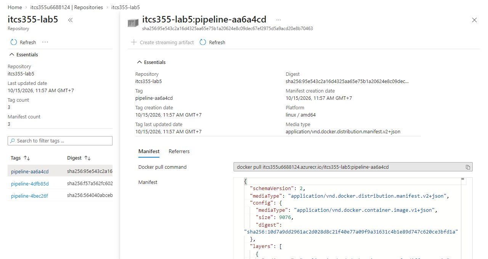

### Deploy-only completed with the scale-to-zero fix — 2026-10-15

I ran `lab5-deploy-only-aa6a4cd-20261015-01` once using the tested `aa6a4cd`
image digest, existing model version 2, and the same serving image and release
identity. The current IP already matched the approved `/32`, so no IP change
was needed. The job used one `cpu-lab5` instance with the same 600-second limit.

The job **completed** and saved `deployment.json`. Its result is
`control_plane_verified`, with `revision_state: scaled_to_zero` and
`http_smoke_tested: false`. Read-back showed the same revision,
`lab5-staging--model2-readfix-1014`, active and `Provisioned`, with
`ScaledToZero`, health `Healthy`, zero replicas, and 100% traffic weight.
The image and model matched, and the HTTPS and IP restrictions were unchanged.
This time the deploy step finished without a timeout, restart, new revision,
or an HTTP request to wake the App.

Azure Studio displayed **2m 14.25s** for the job duration. That is not total
time from submission or a billing measurement. Git metadata now points to our
student repository and commit `aa6a4cd`. The SDK still marked the checkout
dirty because README/evidence was uncommitted; the image came from the committed
Git archive, and no local implementation code was uploaded.

The [result record](reports/lab5-deploy-only-scaled-zero-success.json) includes
the output hash and read-back. At 05:17:29 UTC, compute was `Steady` with zero
current and target nodes. The App also had zero replicas. Shared resources
remain and can still have costs. There was no new training, build, model
registration, role change, commit, or Git push. This verifies deploy-only, not
the whole managed pipeline. HTTP smoke checks were left for the separate step
below. Task 1 remains in progress, and the earlier failed jobs remain failed.

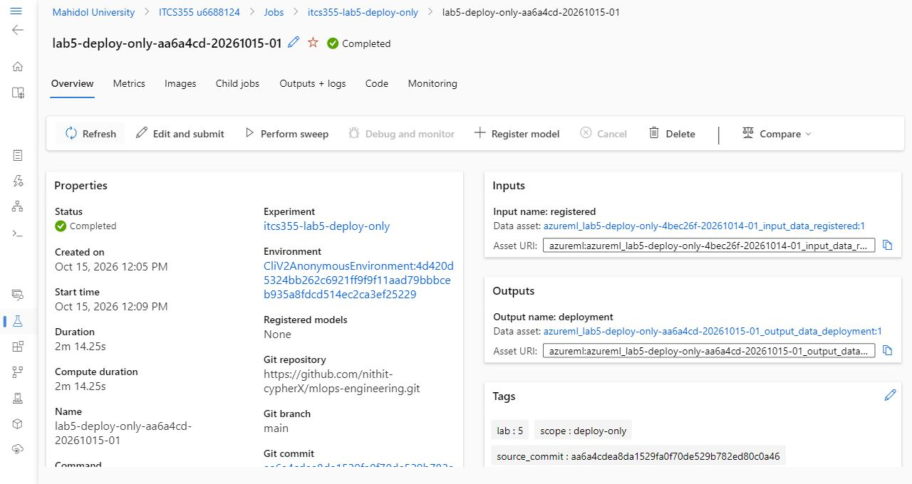

### HTTP smoke check after deploy-only — 2026-10-15

I checked the existing staging API after the successful deploy-only job. The
current IP still matched the approved `/32`, so no configuration changed.
The same revision started at zero replicas with health `Healthy`.

The first `/health` request reached the 30-second read timeout. After a short
wait, the next `/health` returned 200. `/ready` then returned 200, and one
synthetic `/predict` request returned 200 with probability **0.0073735752**.
All three successful responses reported model version **2** in the JSON and
header, and echoed the request ID correctly. The prediction matched the same
sample from the earlier recovery check. The initial timeout is kept in the
[HTTP result record](reports/lab5-post-deploy-http-smoke.json); it happened
while waking from zero replicas, but this check does not isolate exactly where
the startup time was spent.

At **12:24 Thailand time (05:24 UTC)**, the revision was `RunningAtMaxScale`,
`Healthy`, with one replica and 100% traffic weight. Azure ML compute remained
at zero current and target nodes. The App still scales from zero to one; the
HTTP requests woke it, so this is not a zero-cost claim.

This is a separate live serving check, not a load test, accuracy benchmark, or
full managed pipeline run. The job's original `deployment.json` still says
`http_smoke_tested: false` because that job did not make these HTTP requests.
There was no new job, training, build, deployment, role change, commit, or push.
No offline tests were rerun because implementation did not change. Task 1 still
needs end-to-end and managed negative-path verification.

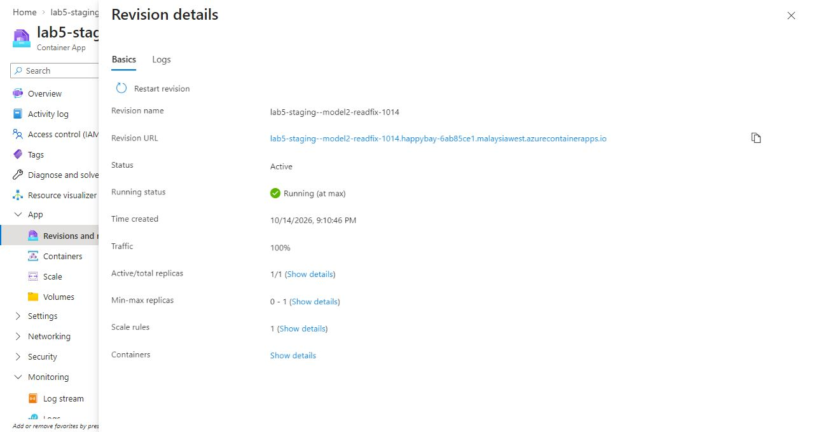

### Full-pipeline draft with step limits — 2026-10-15

I prepared a new private draft named `lab5-normal-aa6a4cd-20261015-01` using
the tested `aa6a4cd` pipeline image digest. Each of the six steps has a
600-second timeout and one `cpu-lab5` instance. This is a limit per step,
not a pipeline-wide time or spending cap. The limits were set on this draft;
the compiler and image code were not changed.

The SDK loaded the saved YAML successfully. I checked the six timeouts,
training/release identities, file handoffs, 0.80 gate, datastores, and the
staging target. The 6,000-row input and DVC metadata were unchanged, and all
14 source-file hashes matched the tested image record. Network, credential,
and subprocess calls were blocked during compilation and reload; none were
attempted. The existing dependencies emitted 143 warnings and experimental
schema notices, but these checks passed.

The draft stays outside Git with directory mode `0700` and file mode `0600`
because it contains the allowed IP. Its SHA-256 is
`914a0a58eafc5200d6f9613186d93064b23001a683f00e3571747a8a200ef730`.
The current IP and job-name availability still need a fresh preflight.
No upload, Azure lookup, pipeline run, training, build, deployment, commit, or
push happened in this step. A future full run would train and register a new
model, then deploy that version only if the gate passes; it would not reuse
model version 2 as a fixed input. Task 1 remains in progress.

### Full managed pipeline completed — 2026-10-15

I submitted `lab5-normal-aa6a4cd-20261015-01` once using the reviewed draft and
the tested `aa6a4cd` image digest. The current IP matched the approved `/32`,
and the job name was unused. The six steps kept their 600-second limits and
used the existing `cpu-lab5` compute and training/release identities.

| Step | Result |
| --- | --- |
| Ingest | Completed; copied the input with the same SHA-256. |
| Validate | Completed; all 6,000 rows passed the data contract. |
| Train | Completed; validation ROC-AUC **0.844499**, test ROC-AUC **0.846673**. |
| Evaluate | Completed; validation ROC-AUC passed the **0.80** gate. |
| Register | Completed; saved and read back model version **3**. |
| Deploy staging | Completed; deployed version 3 to `lab5-staging--0000002`. |

I checked the saved JSON outputs rather than relying only on the green job
status. The input hashes matched, `gate.json` referred to the exact training
result, and the model registry tags matched its Git SHA, data fingerprint,
DVC hash, model hash, and scores. `deployment.json` used the model reference
from this run's `registration.json`, not the older version 2.

Azure read-back showed the new revision as `Provisioned`, `RunningAtMaxScale`,
and `Healthy`, with one replica and 100% traffic weight. The serving image,
HTTPS setting, and approved `/32` restriction were unchanged. The deployment
result is `control_plane_verified`; `http_smoke_tested` is still `false`.
The earlier HTTP checks were for version 2, not this new version.

At **13:03 Thailand time (06:03 UTC)**, Azure ML compute was back to `Steady`
with zero current and target nodes. The App still has its existing zero-to-one
scaling, and shared resources remain; this is not a zero-cost claim.

The [result record](reports/lab5-full-pipeline-aa6a4cd.json) contains the six
output hashes, metrics, registry checks, and resource read-back. Git metadata
points to our student repository and commit `aa6a4cd`. It still marks the
checkout dirty because README/evidence is uncommitted; no local implementation
code was uploaded, and the image came from the committed Git archive.

There was no retry, new build, permission change, commit, or Git push. No offline
tests were rerun because the implementation did not change. This run proves
the normal managed path through deployment. Separate checks below cover
version 3's HTTP responses and both managed negative paths; those checks were
not part of this run. The earlier failed jobs remain failed.

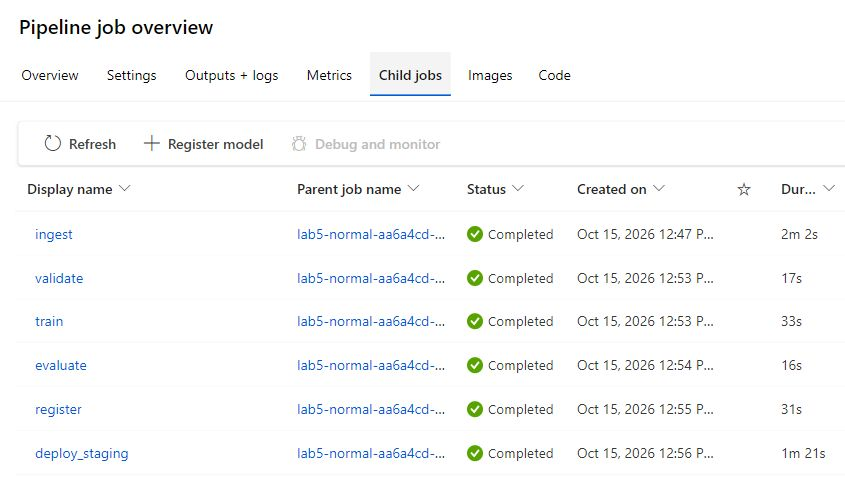

### HTTP smoke check for model version 3 — 2026-10-15

I checked the staging API after the full pipeline completed. The current IP
matched the approved `/32`, and the App still used version 3 on
`lab5-staging--0000002` with the same serving image. No configuration changed.

`/health`, `/ready`, and one synthetic `/predict` request each returned **200**
on the first attempt. All three responses reported **model version 3** in both
the JSON and `x-model-version` header, and echoed the request ID correctly.
The prediction probability was **0.0073735752**, matching the earlier sample
within `1e-12`. This checks one serving response, not model accuracy or load
performance.

Before the requests, the revision was `Healthy` and `ScaledToZero` with zero
replicas. Afterward it was `Healthy` and `RunningAtMaxScale` with one replica
and 100% traffic. Azure ML compute stayed at zero current and target nodes.
The App keeps its zero-to-one scaling; these requests woke it and may incur
normal runtime costs.

The [HTTP result](reports/lab5-model3-http-smoke.json) records all three
requests and the resource checks before and after. The screenshot shows the
revision state, while the JSON contains the HTTP evidence. The pipeline's
original `deployment.json` still says `http_smoke_tested: false` because these
requests were sent separately afterward.

There was no retry, new pipeline job, training, build, deployment, permission
change, commit, or Git push. No offline tests were rerun because implementation
did not change. This checks the deployed API after the normal pipeline. The
managed negative-gate and invalid-data runs are recorded separately below.

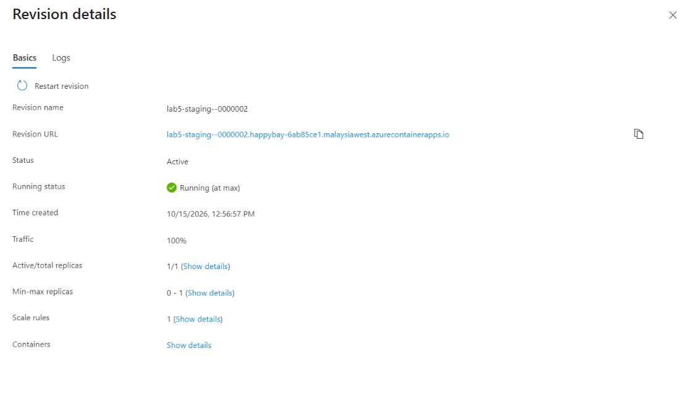

### Managed negative-gate check — 2026-10-15

I ran `lab5-negative-gate-aa6a4cd-20261015-01` once. Compared with the successful
full-run draft, only the job name and gate minimum changed: **0.80 → 0.90**.
The image, data, training settings, identities, and six connected steps stayed
the same. The normal gate is still 0.80; 0.90 was only for this negative test.
An offline check with the previous metrics had already rejected that threshold.

Ingest, validate, and train completed. The new training run gave validation
ROC-AUC **0.844499**, so evaluate returned exit code **1** with this message:

```text
GATE FAIL: val_roc_auc=0.8444994217173845 < minimum 0.9
```

Azure shows this pipeline as **Failed**, which is the expected result here.
There was no `gate.json`, and no register or deploy child job was created.
I checked Azure afterward: model versions were still **1, 2, 3**, and staging
still used model **3** on `lab5-staging--0000002` with 100% traffic weight.
Its image, HTTPS setting, `/32` restriction, and zero-to-one scaling were
unchanged. The revision was `Healthy` and `ScaledToZero`; I did not send any
HTTP requests in this check.

The [result record](reports/lab5-negative-gate-aa6a4cd.json) includes the
metrics, gate log hash, before/after resource checks, and final compute state.
At **13:46 Thailand time (06:46 UTC)**, Azure ML compute was back to `Steady`
with zero current and target nodes. Storage and shared resources remain;
this is not a zero-cost claim.
This full negative run did train once, but did not register or deploy a model.
There was no retry, new build, permission change, commit, or Git push.
No offline tests were rerun because implementation did not change.

This proves the managed pipeline stops when the quality gate fails. The
separate invalid-data check below covers the earlier validation step.

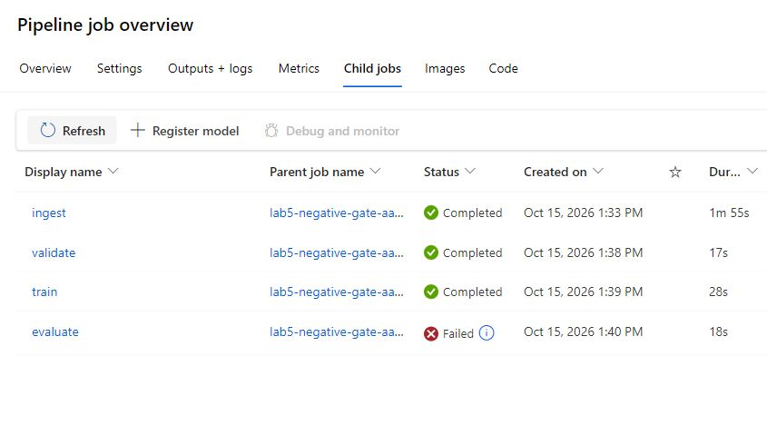

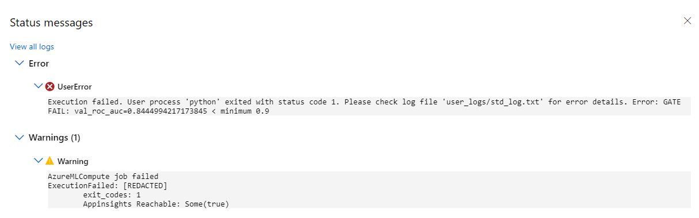

### Managed invalid-data check — 2026-10-15

I ran `lab5-invalid-data-aa6a4cd-20261015-01` once with a copy of the 6,000-row
dataset. Only one cell changed: `reading_id=0`, `load_pct` from **95.792** to
**250.0**. The original CSV and DVC metadata stayed unchanged. This was a
temporary test copy, not a new DVC dataset version. Compared with the normal
draft, only the job name and input path changed; the gate stayed at **0.80**.

Ingest completed and its SHA-256 matched the test copy. Validate returned
exit code **1** with:

```text
VALIDATE FAIL: load_pct outside plausible range [0.0, 100.0]
```

The pipeline was **Failed**, as expected. No `validation.json` was produced,
and no train, evaluate, register, or deploy child job was created. Model
versions stayed **1, 2, 3**. Staging still used model **3** on
`lab5-staging--0000002`, healthy with 100% traffic weight. Its serving image,
HTTPS setting, `/32` restriction, and zero-to-one scaling were unchanged.
No HTTP request was sent to the App in this run.

The [result record](reports/lab5-invalid-data-aa6a4cd.json) contains the input
hashes, validation error, child-job states, and before/after resource checks.
Compute returned to `Steady` with zero current and target nodes at
**14:15:59 Thailand time (07:15:59 UTC)**. There was no retry, training, new
build, permission change, commit, or Git push. This proves rejection of this
one out-of-range input before training, not every invalid-data case.

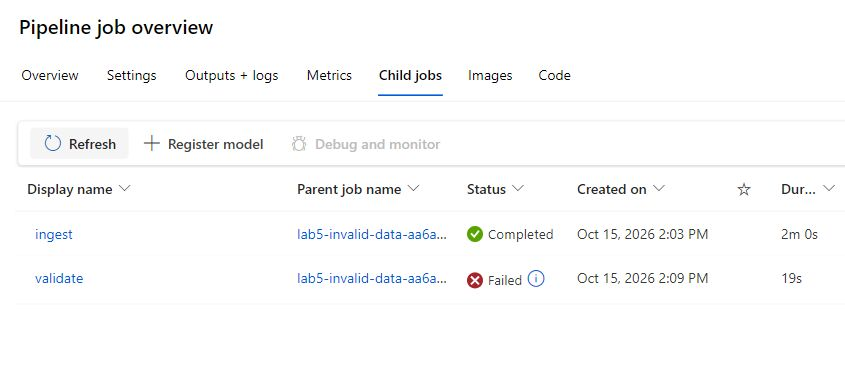

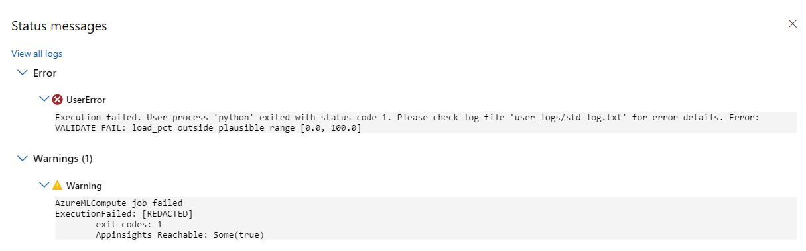

### CI identity created — 2026-10-15

I created `id-itcs355-u6688124-lab5-ci` in Malaysia West, in the existing
`itcs355-u6688124` resource group, with the Lab 5 ownership tags. I read it
back through Azure CLI and checked its Overview page in the portal.

The role-assignment query for its principal returned no assignments, and
its federated-credential list was empty. This confirms the identity exists;
it does not prove that GitHub can log in or that CI has permission to run.
I did not add roles, configure OIDC/GitHub, attach it to compute or the App,
build an image, run a workflow/pipeline, or commit/push. The existing
training, release, and runtime identities were not changed.

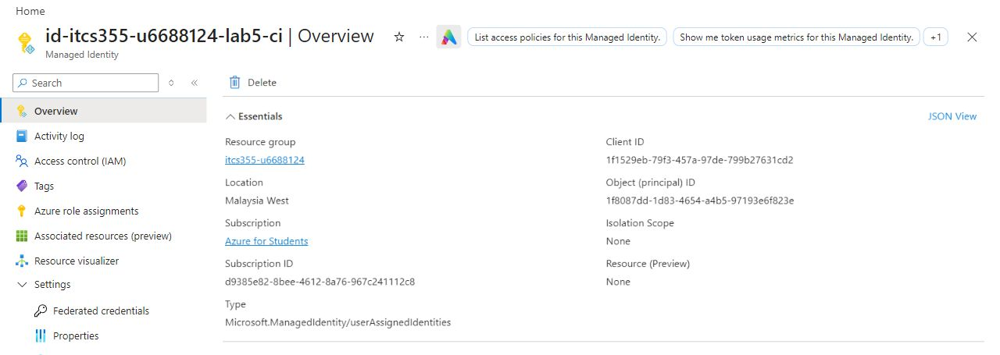

### GitHub CI environment prepared — 2026-10-15

I created the `lab5-ci` environment in `nithit-cypherX/mlops-engineering`.
It allows only the `main` branch, with no tag rules, and its environment
variable `LAB5_CI_ENABLED` is set to `false`. I reloaded the settings page
and checked that both settings were saved. The environment has no secrets.

This prepares the GitHub settings; it does not prove that OIDC login works.
I did not configure OIDC trust, add roles, change Azure, run a workflow or
pipeline, or commit/push. The other GitHub environments were not changed.

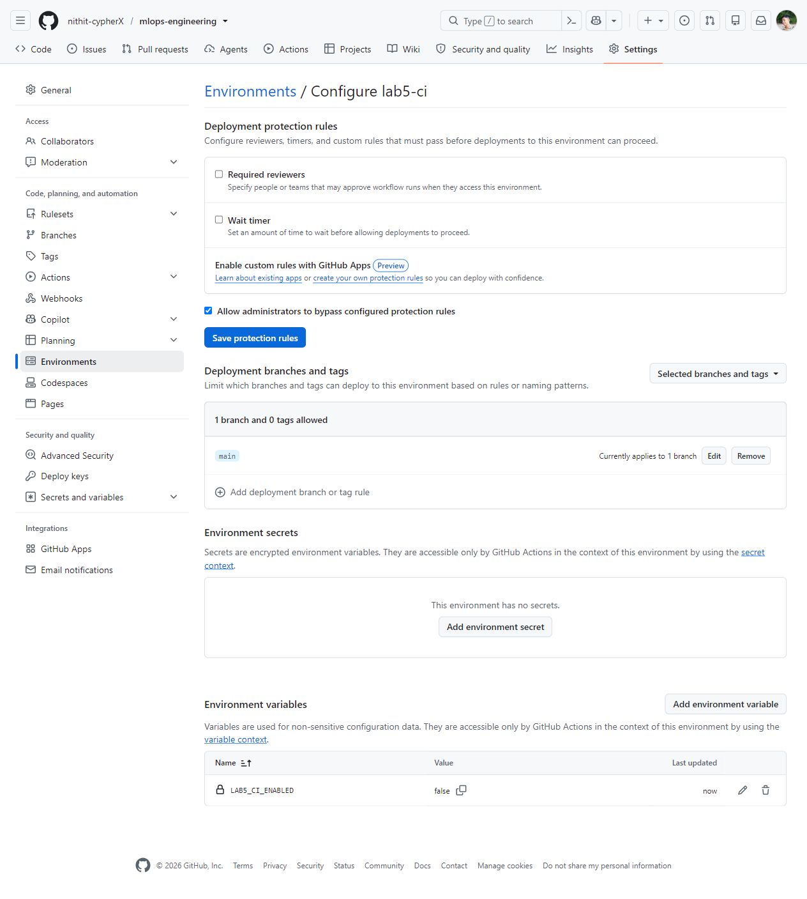

### CI OIDC trust configured — 2026-10-15

I added one federated credential, `github-lab5-ci`, to
`id-itcs355-u6688124-lab5-ci`. It accepts the GitHub issuer
`https://token.actions.githubusercontent.com`, audience
`api://AzureADTokenExchange`, and this exact subject:

```text
repo:nithit-cypherX@90242135/mlops-engineering@1360858721:environment:lab5-ci
```

The IDs match the repository's current GitHub OIDC settings, which use
[immutable subject claims](https://docs.github.com/en/actions/reference/security/oidc#immutable-subject-claims).
The trust is tied to `lab5-ci`; its GitHub environment rule limits access to
the `main` branch. I read the credential back through Azure CLI and checked
it in the portal. The role-assignment query still returned no assignments.
GitHub still has `LAB5_CI_ENABLED=false` and no environment secrets.

The first CLI check failed while loading the existing `ml` extension. I used
the built-in identity commands with extension loading disabled only for
those shell processes. I did not delete, reinstall, or change the extension.
That local CLI issue still needs attention before using `az ml` again.

I updated only the setup comments in the workflow draft to match these
settings. No roles or secrets were added, and no login test, workflow,
pipeline, build, commit, or push was run. This verifies the saved trust
configuration, not a successful GitHub-to-Azure login.

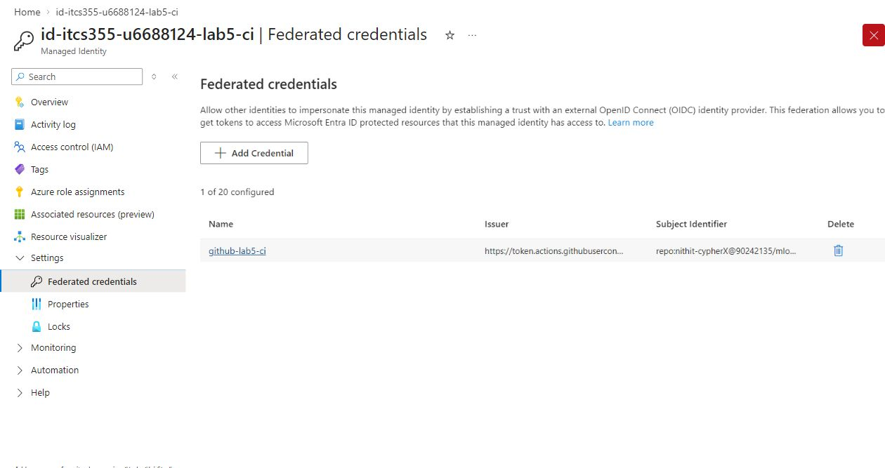

### CI client and tenant IDs saved — 2026-10-15

I read the client ID and tenant ID from `id-itcs355-u6688124-lab5-ci` and
saved them as `LAB5_AZURE_CLIENT_ID` and `LAB5_AZURE_TENANT_ID` in the
GitHub `lab5-ci` environment. These are identity IDs, not a new client
password. After reloading the page, both secret names were listed,
the environment still allowed only `main`, and `LAB5_CI_ENABLED` was
still `false`.

GitHub does not show saved secret values, so this confirms that the two
entries were saved, not that login works. The screenshot shows their names
only. I did not add `LAB5_SERVING_ALLOWED_IP`, change Azure or roles, run
a login test, workflow, pipeline or build, or commit/push. I updated only
the setup comments in the workflow draft; its behavior is unchanged.

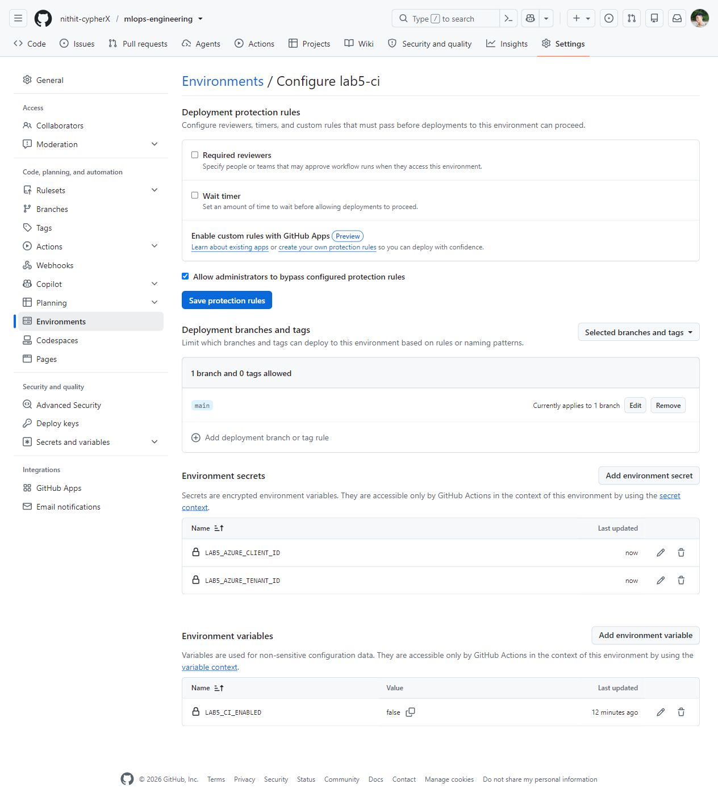

### CI workspace role assigned — 2026-10-16

I created `ITCS355 Lab5 CI Submitter u6688124` from
[`pipeline/ci-role.json`](pipeline/ci-role.json) and assigned it to
`id-itcs355-u6688124-lab5-ci` only at `mlw-itcs355-u6688124`.
Reading it back showed the same **13 actions** as the draft and exactly
**one assignment**, at the workspace, not the resource group. The portal
also showed the role and its assignment. The JSON's resource-group
`AssignableScopes` makes the role available there; it does not grant
resource-group access.

The role lets CI submit/read jobs and resolve the compute, datastores,
components, and image environments used by the pipeline. It has no wildcard,
delete, data, key-reading, or role-assignment actions. The workspace scope is
not limited to Lab 5 job names. CI also has no direct App-write permission,
but submitted jobs can run as the training/release identities and deploy
through the release step, so this remains trusted-main automation.

AcrPush and input-blob access are still pending. I did not change GitHub
settings or enable CI, run a workflow/pipeline, build, or commit/push.
This checks the saved role configuration, not a successful CI login or job.
Only setup comments and this evidence changed locally; no application code
changed, so I did not rerun the offline tests.

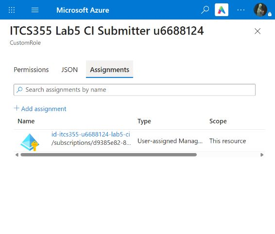

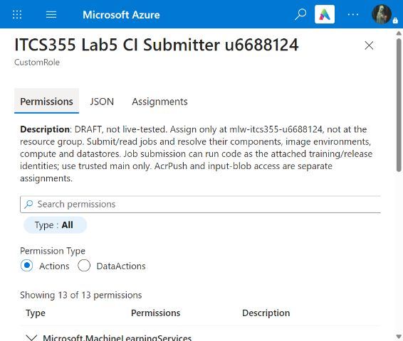

### CI image access assigned — 2026-10-16

I assigned `AcrPush` to `id-itcs355-u6688124-lab5-ci` only at the
`itcs355u6688124` registry. Reading the assignments back showed exactly two:
the existing CI Submitter at the ML workspace and this AcrPush assignment.
The portal showed the same pair. No Blob or resource-group assignment was added.

The registry still uses `LegacyRegistryPermissions`, so this allows push/pull
across that registry, not just the Lab 5 image repository. Its admin user
stayed disabled. I did not change the registry mode, create a password,
log in as CI, or build/push an image. This confirms the saved assignment,
not a successful image push from GitHub.

Input-blob access is still pending. I updated only setup comments and this
evidence locally; no application code changed, so offline tests were not
rerun. GitHub settings were unchanged, CI was not enabled, and no
workflow/pipeline or commit/push was run. The screenshot omits the account
header but keeps the identity, roles, and target resources visible.

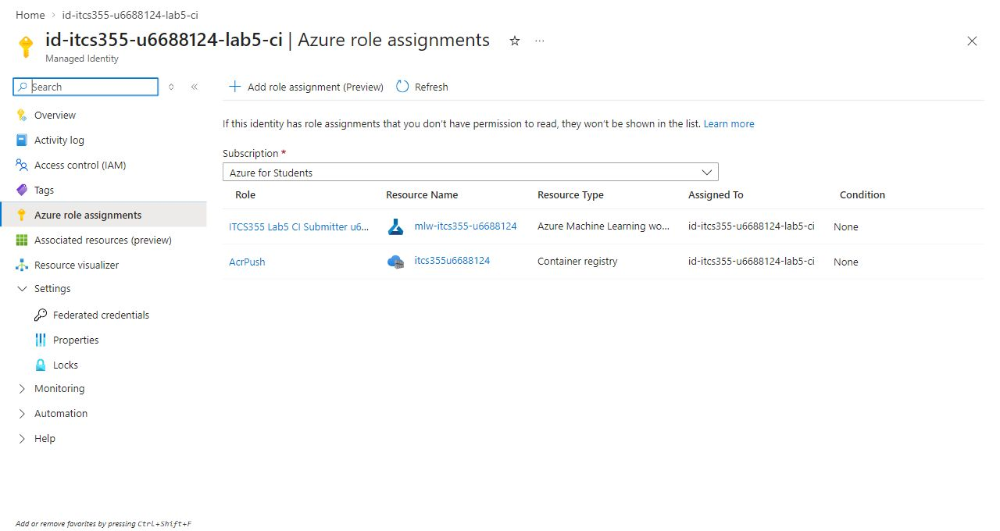

### CI input-blob access assigned — 2026-10-16

I reused `ITCS355 Lab5 Blob Read Write u6688124` without changing its
definition and assigned it to `id-itcs355-u6688124-lab5-ci` only at
`itcs355u6688124/blobServices/default/containers/lab5-inputs`.
The role can read container metadata and read/write blobs. It has no
delete or storage-key actions, but write access can overwrite existing
blobs in this container.

Reading the assignments back showed exactly three: CI Submitter at the
ML workspace, AcrPush at the registry, and Blob Read Write at `lab5-inputs`.
There was no assignment at the storage account, resource group, or
`lab5-artifacts`. The input container still had `publicAccess: None`.
The portal also showed the three assignments; CLI read-back confirmed
the full container scope where the portal table shortened its name.

This verifies the saved permissions, not a successful upload from CI.
I did not upload or change data, enable CI, run a workflow/pipeline,
build, or commit/push. Only setup comments and this evidence changed
locally, so offline tests were not rerun. `LAB5_SERVING_ALLOWED_IP`
is still pending; GitHub settings were unchanged.

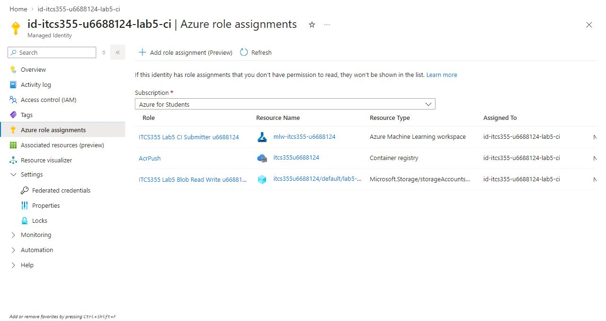

### CI serving IP secret saved — 2026-10-16

With approval, I used `https://api.ipify.org` to check the laptop's current
public IPv4 and saved it with `/32` as `LAB5_SERVING_ALLOWED_IP` in the
GitHub `lab5-ci` environment. I checked the entered value before saving
without printing it. After reloading, the page showed all three secret
names, `main` as the only allowed branch, and `LAB5_CI_ENABLED=false`.

GitHub does not reveal saved secret values, so the screenshot confirms the
entry exists, not its hidden value or a successful CI run. It shows no IP.
The temporary IP file was removed; the IP was not added to the repository.
This is the allowed client IP for a future deployment, not the GitHub
runner's IP. If the connection's public IP changes, this secret needs updating.

I did not change Azure ingress, local `cloud.env`, roles, or CI enablement.
No workflow/pipeline, build, commit, or push was run. Only setup comments
and this evidence changed locally, so offline tests were not rerun.

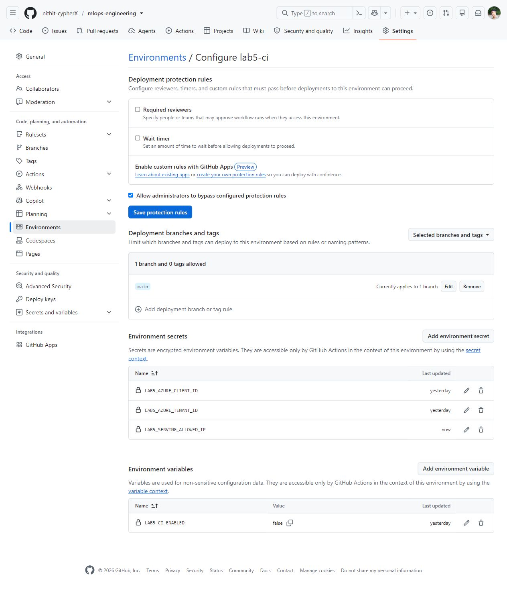

### First CI run and SDK name fix — 2026-10-16

[CI run #1](https://github.com/nithit-cypherX/mlops-engineering/actions/runs/38871785785)
passed the offline checks, OIDC login, and image push, but failed before the
managed job was created. The SDK looked for a compute named
`azureml:cpu-lab5` instead of `cpu-lab5`. After that run, the job lookup returned
not found, compute had zero current/target nodes, and staging was unchanged.
I set `LAB5_CI_ENABLED` back to `false` and did not retry.

The compiler now passes plain names for `compute` and `default_datastore`.
The offline check also found that the old datastore prefix produced the wrong
resource ID; the failed CI run had stopped earlier at compute validation.
YAML export still adds `azureml:`, and loading that YAML restores plain names.
The older tests checked YAML and mocked submission, so they missed the direct
Python SDK path used by CI.

**Checks:** With `azure-ai-ml==1.35.0`, the new regression tests failed for both
direct-object cases before the fix, while both YAML cases passed. After the
fix, all **60 compiler/CI tests** and the full **491-test Lab 5 suite** passed
offline, along with Ruff. The tests check the SDK's compute lookup for all six
steps and its datastore resource ID, using a mock instead of a cloud lookup.
The full suite reported **1,637 warnings**, including dependency deprecation
warnings. I used the existing Python 3.11.16 environment with networking disabled:

```bash
unshare -Urn env PYTHONDONTWRITEBYTECODE=1 PYTEST_DISABLE_PLUGIN_AUTOLOAD=1 \
  ../lab2/.venv/bin/python -B -m pytest -q -p no:cacheprovider tests cloudlayer/tests --disable-warnings
unshare -Urn env PYTHONDONTWRITEBYTECODE=1 \
  ../lab2/.venv/bin/python -B -m ruff check --no-cache \
  --config ../lab4/ruff.toml src cloudlayer scripts tests
```

This is a local fix, not a successful CI rerun. I did not change the workflow,
dependencies, roles, or Azure resources, build an image, rerun CI, or commit/push
during this fix. The screenshots below are from the earlier failed run and its
disablement, not a new cloud check.

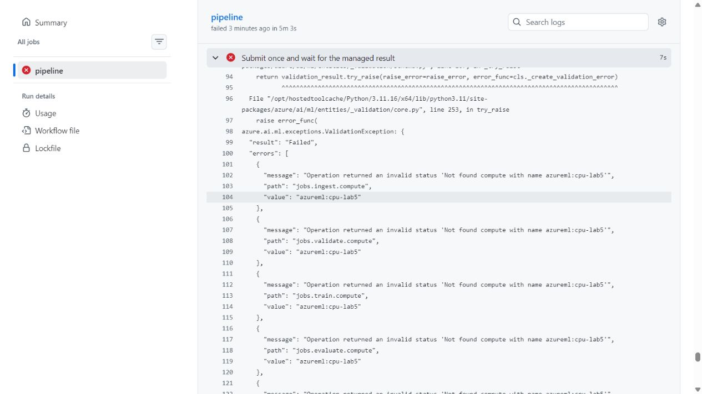

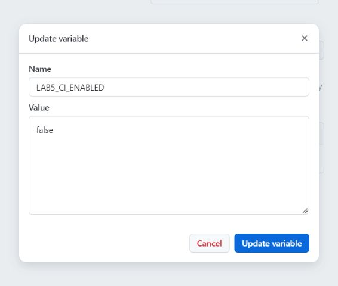

### Second CI run stopped at component permissions — 2026-10-16

I ran [CI #2](https://github.com/nithit-cypherX/mlops-engineering/actions/runs/38876116346)
once from `cc84eec`. The tests, image checks, OIDC login, and ACR push passed.
The SDK got past compute validation, but component registration failed because
the CI identity did not have
`Microsoft.MachineLearningServices/workspaces/modules/write`. This is a different
error from the compute-name problem. The pipeline job failed after **5m 23s**.

The Azure ML job `lab5-ci-38876116346-1` was not created. At **15:54 Thailand time**,
compute had zero current and target nodes, model versions were still **1, 2, 3**,
and staging still used `lab5-staging--0000002`, with that same ready revision
and 100% traffic weight. No managed training or deployment ran from this attempt.
The pushed image remains in ACR; its tag and digest are in the
[result record](reports/lab5-ci-second-run.json). I did not audit other preparatory
ML assets, so this is not a claim that the run made no cloud changes.

I set `LAB5_CI_ENABLED` back to `false` and checked the saved value. I stopped
without adding permissions, applying another fix, or rerunning CI. These notes
and screenshots are local evidence only; no Git commit or push was made.
CI has not yet completed an end-to-end managed run.

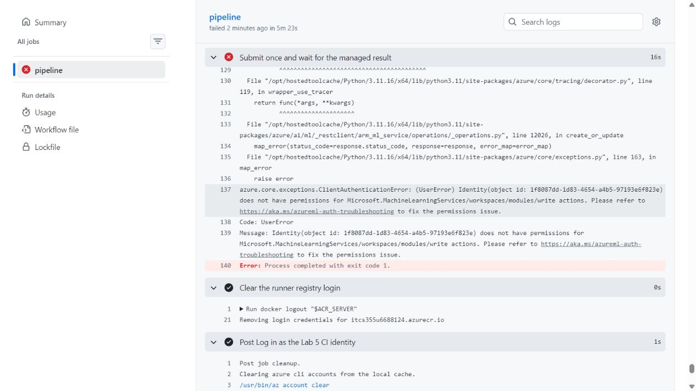


### CI component permission draft — 2026-10-16

I added only `Microsoft.MachineLearningServices/workspaces/modules/write` to
[pipeline/ci-role.json](pipeline/ci-role.json), bringing the local draft to
14 explicit actions. CI #2 reported this missing permission while registering
a component. The earlier read-only check confirmed that the Azure role matched
the old 13-action file and was assigned only at `mlw-itcs355-u6688124`.
Microsoft lists `modules` and `components` as different action paths in its
[role documentation](https://learn.microsoft.com/en-us/azure/machine-learning/how-to-assign-roles?view=azureml-api-2#differences-between-actions-for-v1-and-v2-apis).

I kept the other actions and scopes unchanged. I did not add wildcards, delete
permissions, secret access, or `modules/read`. The existing test now requires
exactly the reviewed 14 actions and still checks the scope and safety limits.

**Checks:** The updated role test failed against the old 13-action file. After
the action was added, all **19 CI tests** and Ruff on the changed test file
passed in the existing environment with networking disabled. Pytest reported
586 warnings. I did not rerun the full Lab 5 suite for this role-only change.

This is a local draft, not an Azure permission update or a successful CI run.
The offline checks verify the role file and CI guards, not Azure's effective
permissions. I did not change the workflow, pipeline code, dependencies, Azure,
or GitHub settings, build an image, run CI, or commit/push. The live role update
and one approved CI run are still needed to verify this fix end to end.

### CI component permission applied — 2026-10-16

With approval, I updated the existing CI role once, adding only
`Microsoft.MachineLearningServices/workspaces/modules/write`. Reading the role
back by its ID showed 14 actions. The other permissions, role ID, name,
description, and assignable scopes were unchanged. The role still had one
assignment: the Lab 5 CI identity at `mlw-itcs355-u6688124`, not the whole
resource group. I did not create or change any role assignment.

The first role-list read still showed 13 actions. A later direct read and the
Portal showed 14; I did not send another update. The screenshots show the role
name and the added action, with only the top account bar cropped out.

This confirms the saved role definition, not a successful CI run or that the
new permission has propagated everywhere. I did not enable or run CI, submit a
pipeline, build an image, deploy, or commit/push. Only this evidence and its
screenshots changed locally in this step, so I did not rerun code tests.

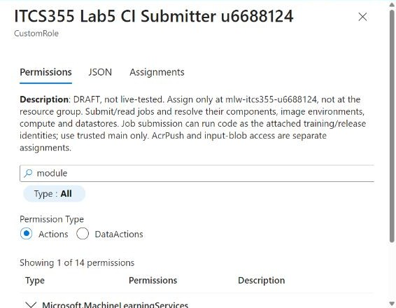

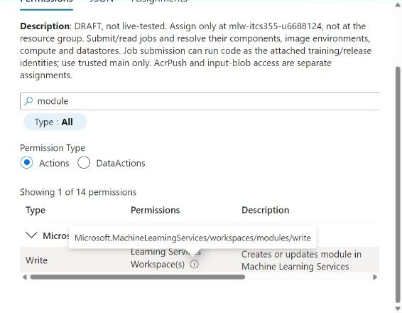

### Third CI run stopped at component read permission — 2026-10-18

I ran [CI #3](https://github.com/nithit-cypherX/mlops-engineering/actions/runs/39093305091)
once from commit `1fb7a9f28ef6067f9bfc335b8a78b7e78facede3`. All **491 tests**
and Ruff passed; pytest reported 1,637 warnings. Data restore, the `linux/amd64`
image build and offline image checks, OIDC login, and the ACR push also passed.

The submission step failed after 18 seconds while registering a component.
Azure now reported missing `Microsoft.MachineLearningServices/workspaces/modules/read`,
not the `modules/write` action reported in CI #2. The role had the reviewed
14 actions before this run, but did not include `modules/read`. I did not add
another permission or retry the run.

The parent job `lab5-ci-39093305091-1` was not found after the failure.
Compute stayed at 0 current/target nodes, the registered model versions stayed
at 1–3, and staging still used ready revision `lab5-staging--0000002` with 100%
traffic. This run did not reach managed training or deployment. Its new image
remains in ACR; I did not audit every preparatory AML asset.

I restored `LAB5_CI_ENABLED=false` after the first guard passed and verified it
again after the failure. The updated IP secret is saved in GitHub, but this
failed run did not update the App's existing IP allowlist. I did not change
roles, rerun CI, commit, or push after the failure.

Details: [third CI run report](reports/lab5-ci-third-run.json).

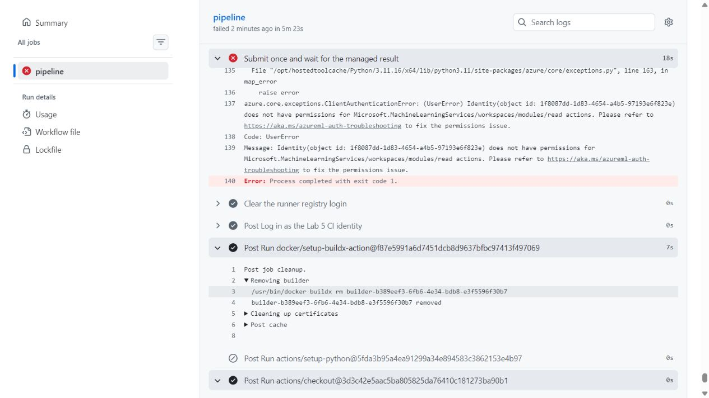


### CI component read permission draft — 2026-10-18

I added only `Microsoft.MachineLearningServices/workspaces/modules/read` to
[pipeline/ci-role.json](pipeline/ci-role.json), because CI #3 reported this exact
missing action. The local draft now has 15 explicit actions. The other actions,
role settings, and scopes are unchanged; no wildcard, delete, or secret access
was added. The existing test now checks the exact 15-action list and keeps the
scope and safety checks.

**Checks:** The updated role test failed against the old 14-action draft. After
adding `modules/read`, all **19 CI tests** and Ruff on the changed test file
passed in the existing Lab 2 environment with networking disabled. Pytest
reported 586 dependency warnings. I did not rerun the full Lab 5 test suite.

This is a local draft change, not a live permission update or a successful CI
run. These checks do not prove that Azure will accept the next submission. I
did not change Azure or GitHub settings, run CI, build an image, commit, or push.

### CI component read permission applied — 2026-10-18

With approval, I updated the existing CI role once, adding only
`Microsoft.MachineLearningServices/workspaces/modules/read`. Reading it back
from Azure showed 15 actions, matching the reviewed draft. The role ID, name,
description, other actions, and scopes were unchanged. Its one assignment was
still the Lab 5 CI identity at `mlw-itcs355-u6688124`; I did not add or change
any role assignment.

The Portal also showed 15 permissions and the new module-read action. The
screenshots below are real Portal captures with the top account bar cropped
out. This confirms the saved role, not that CI now works or that the permission
has propagated everywhere. I did not enable or run CI, build an image, submit
a pipeline, deploy, commit, or push. No code changed in this step, so I did not
rerun the local tests.


### Fourth CI run stopped at experiment-run read permission — 2026-10-19

I ran [CI #4](https://github.com/nithit-cypherX/mlops-engineering/actions/runs/39190820038)
once from `292daad`. Tests, Ruff, data restore, the image build and offline image
checks, OIDC login, and the ACR push passed. Submission failed after 30 seconds
because the CI identity lacked
`Microsoft.MachineLearningServices/workspaces/experiments/runs/read`.
This is a different action from the `modules/read` error in CI #3.

After the failure, Azure could not find parent job `lab5-ci-39190820038-1`.
Compute had 0 current/target nodes, and staging still used ready revision
`lab5-staging--0000002` with 100% traffic. This run did not reach managed training
or deployment. The new image remains in ACR; I did not audit every preparatory
ML asset. I restored `LAB5_CI_ENABLED=false` after the first guard passed and
checked it again after the failure. I did not add permissions or rerun CI.


### CI experiment-run read permission draft — 2026-10-19

I added only `Microsoft.MachineLearningServices/workspaces/experiments/runs/read`
to [pipeline/ci-role.json](pipeline/ci-role.json), bringing the draft from 15 to
16 actions. The other permissions, role settings, and scopes are unchanged.
The test checks the exact list and still rejects wildcards, delete, and secret
access. This read action covers runs across the assigned workspace, not only
Lab 5 ([Azure permission reference](https://learn.microsoft.com/en-us/azure/role-based-access-control/permissions/ai-machine-learning#microsoftmachinelearningservices)).

**Checks:** The updated role test failed against the old 15-action draft. After
the addition, all **19 CI tests** and Ruff on the changed test file passed in the
existing Python 3.11.16 environment with networking disabled. Pytest reported
586 dependency warnings. I did not rerun the full Lab 5 suite.

This is a local draft fix, not an Azure role update or proof that CI now passes.
I did not change the workflow, pipeline code, Azure or GitHub settings, build an
image, rerun CI, commit, or push in this step.

### CI experiment-run read permission applied — 2026-10-19

I added only `Microsoft.MachineLearningServices/workspaces/experiments/runs/read`
to the existing `ITCS355 Lab5 CI Submitter u6688124` role on Azure. Reading it back
confirmed 16 actions, with no removed actions or changes to the other role
settings. The same single assignment still gives the CI identity this role at
the ML workspace only; I did not add or widen any assignment.

The Portal also showed 16 permissions and the added run-read action. I saved the
screenshots below with the top account bar cropped out. GitHub still showed
`LAB5_CI_ENABLED=false`. This confirms the saved role, not that the permission
has propagated everywhere or that CI now passes. I did not run CI or a pipeline,
build, deploy, commit, or push. No code changed in this step, so I did not rerun
the offline tests.


### Fifth CI run stopped at run-submission permission — 2026-10-19

I ran [CI #5](https://github.com/nithit-cypherX/mlops-engineering/actions/runs/39194245410)
once from `300ac5d`. Tests, Ruff, data restore, the image build and offline image
checks, OIDC login, and the ACR push passed. The submission step failed after
27 seconds because the CI identity lacked
`Microsoft.MachineLearningServices/workspaces/experiments/runs/submit/action`.
The role already had `jobs/write` and `experiments/runs/read`, but these did not
cover the permission Azure requested. The GitHub job finished as failed after
5m 9s; this was not a failure inside a running managed pipeline.

After the failure, parent job `lab5-ci-39194245410-1` was not found. Compute had
0 current/target nodes, and staging still used ready revision
`lab5-staging--0000002` with 100% traffic. No managed training or deployment was
observed from this attempt. The new image was pushed to ACR; I did not audit
every preparatory ML asset. I restored `LAB5_CI_ENABLED=false` after the first
guard passed and checked it again after the failure. I did not add permissions
or rerun CI.


### CI run-submission permission draft — 2026-10-19

I added only `Microsoft.MachineLearningServices/workspaces/experiments/runs/submit/action`
to [pipeline/ci-role.json](pipeline/ci-role.json), bringing the local draft from
16 to 17 actions. Microsoft lists this separately from `jobs/write` and run-read
access in its [permission reference](https://learn.microsoft.com/en-us/azure/role-based-access-control/permissions/ai-machine-learning#microsoftmachinelearningservices).
CI #5 is the evidence that our submission path also needs it; this does not
establish an SDK bug or a switch to V1.

The other actions, role settings, and scopes are unchanged. The test requires
the exact 17-action list and keeps the scope, duplicate, wildcard, delete, and
secret-access checks. This is permission to submit work, not just read it. The
existing workspace assignment is not limited to Lab 5 job names, and submitted
jobs can use the attached training/release identities, so trusted-main limits
still matter.

**Checks:** The updated role test failed against the old 16-action draft. After
adding the action, all **19 CI tests** and Ruff on the changed test file passed
in the existing environment with networking disabled. Pytest reported 586
warnings. I did not rerun the full Lab 5 suite for this role-only change.

This change is local only. The offline checks verify the draft and CI guards,
not Azure's effective permissions or a successful managed run. I did not change
the workflow, pipeline code, dependencies, Azure or GitHub settings, build an
image, rerun CI, commit, or push in this step.

### CI run-submission permission applied — 2026-10-19

With approval, I added only
`Microsoft.MachineLearningServices/workspaces/experiments/runs/submit/action`
to the existing `ITCS355 Lab5 CI Submitter u6688124` role on Azure. Direct
read-back confirmed 17 actions matching the reviewed draft. The role ID, name,
description, other permissions, and assignable scopes were unchanged. A separate
read confirmed the same CI identity and existing assignment at the ML workspace;
I did not add or widen any role assignment.

The Portal showed 17 permissions and the new submission action. I saved the
screenshots below with the account bar cropped out. GitHub still showed
`LAB5_CI_ENABLED=false`. This confirms the saved role, not that the permission
has propagated everywhere or that CI now passes. I did not run CI or a pipeline,
build, deploy, commit, or push. Only this evidence and its screenshots changed
locally in this step, so I did not rerun code tests.


### CI run and artifact permission draft — 2026-10-19

[CI #7](https://github.com/nithit-cypherX/mlops-engineering/actions/runs/39208593755)
still returned `UserError: Forbidden` when creating the managed job, about
2 hours 35 minutes after the last role update. The Activity Log matched the CI
identity and showed `jobs/write`, which the role already allowed. Its error
details did not name the missing permission. Waiting longer did not resolve
this attempt; this does not prove which internal permission check failed.

I added five actions to the local [role draft](pipeline/ci-role.json), bringing
it from 17 to 22 actions. The following names are relative to
`Microsoft.MachineLearningServices/workspaces/`:

- `experiments/read` and `experiments/write`: read or create/update experiments.
- `experiments/runs/write`: create/update run records.
- `metadata/artifacts/read` and `metadata/artifacts/write`: read or create/update
  artifact metadata in Azure ML.

These are proposed additions based on Microsoft's
[job-submission guidance](https://learn.microsoft.com/en-us/azure/machine-learning/how-to-assign-roles?view=azureml-api-2#common-scenarios)
and [custom-role examples](https://learn.microsoft.com/en-us/azure/machine-learning/how-to-assign-roles?view=azureml-api-2#example-custom-roles).
The generic guidance includes more permissions; this draft is a bounded next
change, not proof that all five are required or that submission will succeed.
The existing 17 actions and all other role fields are unchanged. The intended
assignment stays at the ML workspace, which covers other labs' experiments and
artifacts too, not just Lab 5. I did not add wildcards, delete or secret access,
compute-management actions, or any storage-role assignment.

**Checks:** The updated role test failed against the old 17-action draft. After
the additions, all **19 CI tests** passed with networking disabled in the
existing Python 3.11.16 environment, with 586 dependency warnings. Ruff passed
for the changed test file using the existing `--config ../lab4/ruff.toml`.
My first lint command omitted that config and reported `S102` on the unchanged
`exec` fixture; I corrected the command without changing code or lint rules.
I did not rerun the full Lab 5 suite for this role-only change.

Only the role draft, its test, and this evidence changed in this step. Azure
still has the earlier 17-action role; I did not change Azure or GitHub settings,
build, run CI or a pipeline, commit, or push. Offline tests check the exact
permission list and CI guards, not Azure's effective access or a successful run.

### CI run and artifact permissions applied — 2026-10-19

With approval, I added the five actions listed above to the existing
`ITCS355 Lab5 CI Submitter u6688124` role at 06:35 UTC. Direct read-back confirmed
22 actions matching the reviewed draft. The original actions, role ID, name,
description, and assignable scopes are unchanged.

Before and after the update, this role had one assignment: the CI identity at
the exact ML workspace. That assignment is unchanged. The permissions cover
the workspace, not only Lab 5 job names. I did not add any other permissions or
role assignments.

The Portal showed 22 permissions and the added experiment/run/artifact actions.
The screenshots below exclude the account bar. GitHub still showed
`LAB5_CI_ENABLED=false`. This verifies the saved role, not propagation everywhere
or a successful CI run. I did not run CI or a pipeline, build, deploy, commit,
or push. No code changed in this step, so I did not rerun the offline tests.


### Eighth CI run stopped before child jobs — 2026-10-19

I ran [CI #8](https://github.com/nithit-cypherX/mlops-engineering/actions/runs/39214999596)
once from `a8ae44a`. Tests, Ruff, data restore, the image build and offline image
checks, OIDC login, and the ACR push passed. Azure created parent job
`lab5-ci-39214999596-1`, but it ended as **Failed**. Azure ML Studio reported
`JobSubmissionFailure`: the CI identity lacked
`Microsoft.MachineLearningServices/workspaces/datasets/registered/write`.
The child-job list was empty, so this attempt did not reach training, model
registration, or deployment. Accepting the parent job was not a successful run.

Read-only checks matched the identity in the error to the CI identity and
confirmed that its 22-action role did not include this permission. Compute had
0 current/target nodes, and staging still used `lab5-staging--0000002`.
I restored `LAB5_CI_ENABLED=false` after the first guard passed and confirmed it
again after the failure and during diagnosis. I did not rerun CI.


### CI dataset registration permission draft — 2026-10-19

I added only `Microsoft.MachineLearningServices/workspaces/datasets/registered/write`
to the local [role draft](pipeline/ci-role.json), bringing it from 22 to 23
actions. This is the exact permission named by CI #8, not a change to the
training or deployment code. It allows creating or updating registered datasets
in Azure ML, not registering models or granting direct Blob Storage access.
The intended assignment stays at the existing ML workspace and is not limited
to Lab 5 dataset names. All other role fields and the original 22 actions are
unchanged; no wildcard, delete, secret, or compute-management access was added.

**Checks:** The updated role test failed against the old 22-action draft. After
the addition, all **19 CI tests** and Ruff on the changed test file passed with
networking disabled in the existing environment. Pytest reported 586 warnings.
The test checks the exact 23-action list and keeps the existing scope and safety
checks. I did not rerun the full Lab 5 suite for this role-only change.

This is a local draft, not an applied Azure permission or proof that CI passes.
The last live read-back still had 22 actions. I did not change Azure or GitHub
settings, the workflow, pipeline code, or dependencies, and did not build,
rerun CI, commit, or push in this step.

### CI dataset registration permission applied — 2026-10-19

With approval, I added only
`Microsoft.MachineLearningServices/workspaces/datasets/registered/write` to the
existing `ITCS355 Lab5 CI Submitter u6688124` role at 07:40 UTC. Direct read-back
confirmed 23 actions matching the reviewed draft. The original 22 actions, role
ID, name, description, other permission fields, and assignable scopes are unchanged.

Before the update, this role had one assignment: the CI identity at the exact
ML workspace. Reading that assignment back confirmed it was unchanged. I did
not create or widen any assignment. The permission covers registered datasets
in that workspace, not only Lab 5 dataset names.

The Portal showed 23 permissions and the added dataset-write action. The
screenshots below exclude the account bar. GitHub still showed
`LAB5_CI_ENABLED=false`. This confirms the saved role, not propagation everywhere
or a successful CI run. I did not run CI or a pipeline, build, deploy, commit,
or push. Only this evidence and its screenshots changed locally in this step;
the role draft and tests from the previous step are unchanged.


### Ninth CI run stopped at ingest — 2026-10-19

I ran [CI #9](https://github.com/nithit-cypherX/mlops-engineering/actions/runs/39220449466)
once from `f7074a8`. Tests, Ruff, data restore, image build and offline image
checks, OIDC login, and the ACR push passed. Azure created parent job
`lab5-ci-39220449466-1` and an `ingest` child job. The child failed because the
CI identity lacked `Microsoft.MachineLearningServices/workspaces/datasets/registered/read`.
Its compute duration was 0 seconds. This attempt did not reach training,
model registration, or deployment.

After the failure, compute had 0 current/target nodes and staging still used
`lab5-staging--0000002`. I restored `LAB5_CI_ENABLED=false` after the first guard
passed and checked it again after the run. I did not add permissions or rerun CI.


### CI dataset-read permission draft — 2026-10-19

I added only `Microsoft.MachineLearningServices/workspaces/datasets/registered/read`
to the local [role draft](pipeline/ci-role.json), bringing it from 23 to 24
actions. This is the permission named in CI #9's ingest error. Azure treats
reading registered datasets separately from creating or updating them
([permission reference](https://learn.microsoft.com/en-us/azure/role-based-access-control/permissions/ai-machine-learning)).
The original 23 actions and all other role fields are unchanged. The intended
assignment stays at the same ML workspace, so it covers registered datasets
there, not only Lab 5 names. This does not grant direct Blob Storage access.

**Checks:** The updated role test failed against the old 23-action draft. After
the addition, all **19 CI tests** and Ruff on the changed test file passed with
networking disabled in the existing environment. Pytest reported 586 dependency
warnings. The tests check the exact 24-action list and retain the existing scope,
no-wildcard, no-delete, and no-secret checks. I did not rerun the full Lab 5 suite.

This is a local draft, not an applied Azure permission or proof that CI passes.
The last confirmed live role still had 23 actions. In this draft step, I changed
only the role file, its test, and this evidence. I did not change Azure or GitHub
settings, the workflow, pipeline code, or dependencies, and did not build,
run CI or a pipeline, commit, or push.

### CI dataset-read permission applied — 2026-10-19

With approval, I added only
`Microsoft.MachineLearningServices/workspaces/datasets/registered/read` to the
existing `ITCS355 Lab5 CI Submitter u6688124` role at 08:25 UTC. Direct read-back
confirmed 24 actions matching the local draft. The original 23 actions, role ID,
name, description, other permission fields, and assignable scopes are unchanged.

Before and after the update, the role had one assignment: the CI identity at
`mlw-itcs355-u6688124`. That assignment is unchanged. I did not add permissions
to any other identity or widen the assignment scope. The new action covers
registered datasets in this workspace, not only Lab 5 names.

The workspace IAM page showed 24 permissions and the added dataset-read action.
The screenshots exclude the account bar. GitHub still showed
`LAB5_CI_ENABLED=false` ([screenshot](reports/screenshots/lab5-ci-role24-ci-disabled-2026-10-19.jpg)).
This confirms the saved role, not a successful CI run. I did not run CI or a
pipeline, build, deploy, commit, or push. Only this evidence and the screenshots
changed locally in this step; the role draft and tests are unchanged.


### Tenth CI run passed — 2026-10-19

I ran [CI #10](https://github.com/nithit-cypherX/mlops-engineering/actions/runs/39226985486)
once from `5c1483e`. It passed in 16 minutes 34 seconds. Tests, Ruff, data
restore, image build and offline image checks, OIDC login, and the ACR push
all passed. The managed job `lab5-ci-39226985486-1` completed all six steps:
ingest, validate, train, evaluate, register, and deploy_staging.

Reading the App back confirmed revision `lab5-staging--0000003` was
`Provisioned` and `Healthy`, using model version `4`. The App's allowlist
matched the approved current IP as a single `/32` rule. This was a real
managed deployment, not a mock or a dry run. I did not run a separate API
smoke test in this step.

I restored `LAB5_CI_ENABLED=false` after the first guard passed and checked it
again after the successful run. I did not add permissions, rerun CI, change
implementation code, commit, or push. The screenshots below show the successful
run and the disabled flag; they do not expose the IP secret.


## Task 2 — Scoped identities and permission test

### Current permission summary — 2026-10-19

I checked 15 direct role assignments across four identities against the code
and live Azure configuration. The table below replaces the earlier proposed
access table as the current summary. The older notes remain as setup history.
Identity names use the prefix `id-itcs355-u6688124-lab5-`.

| Identity | Access and scope | Why it is there |
|---|---|---|
| **training** — 4 assignments | Blob Reader on `lab5-inputs`; custom Blob Read Write on `lab5-artifacts`; AcrPull on the ACR; Model Registrar on the ML workspace. | Read training data, save run/model files and metrics, pull the job image, and register/read back the model. It does not receive App deployment permissions. |
| **runtime** — 3 assignments | Blob Reader on `lab5-artifacts`; AcrPull on the ACR; Model Reader on the ML workspace, including `metadata/artifacts/read`. | Read blobs directly, pull the serving image, and load the numbered model through MLflow. Direct Blob Reader was restored after the experiment below; that experiment found it was not needed for the tested MLflow load. |
| **ci** — 3 assignments | Custom Blob Read Write on `lab5-inputs`; AcrPush on the ACR; CI Submitter on the ML workspace. | Upload pipeline inputs, publish the tested image, and submit/track jobs with the component, environment, dataset, and artifact operations the SDK uses. Deployment runs through the release step, not a direct App grant to CI. |
| **release** — 5 assignments | Custom Blob Read Write on `lab5-artifacts`; AcrPull on the ACR; read/join on `feedbackpulse-env`; read/assign on the runtime identity; App read/write and revision read on `lab5-staging`. | Read the registration result, save the deployment report, pull the step image, attach the reviewed environment/runtime identity, and update/check staging. It has no App-delete or environment-update grant. |

Runtime logs go to stdout/stderr for platform collection; this path does not
need a Log Analytics Contributor grant on runtime. The custom Blob Read Write
role allows read/write, not blob deletion or storage account key access.

**Limits:** The ACR grants cover the registry, not just one repository, and
the model grants cover the workspace, not just one model name. Training and
release share one compute cluster, so selecting different client IDs is not
isolation from untrusted job code. CI can submit that trusted pipeline and
therefore trigger deployment through release. This was a direct-assignment
review, not a full audit of permissions inherited through Entra groups.

The [baseline](reports/lab5-runtime-permission-baseline-2026-10-19.json) and
[removal/recovery test](reports/lab5-runtime-permission-removal-2026-10-19.json)
below show what happened when one runtime assignment was removed. The original
assignment is restored; there is no permanent permission change from the test.

### Runtime permission baseline — 2026-10-19

I checked both model-reading paths before removing any permission. In a fresh
Python process inside the existing `lab5-staging--0000003` replica, the runtime
identity read the version 4 `MLmodel` file directly from `lab5-artifacts` using
OAuth, without a SAS or account key. It then loaded
`models:/itcs355-u6688124-lab5/4` through MLflow into a new, empty temporary
directory. Both checks passed. MLflow selected `ManagedIdentityCredential`,
and the principal matched the runtime identity. The `MLmodel` SHA-256 matched
between the two paths. The check took 11.8 seconds, excluding App startup.

**Obstacle:** My current IP no longer matched the App's allowlist, so the first
health request returned 403. With approval, I updated only the existing App
allow rule to the current IPv4 `/32`. Read-back confirmed the template,
identity, and revision were unchanged. The App was scaled to zero; the first
cold-start request timed out, then the existing replica became ready without
a restart. After the baseline, `/ready` returned 200 with model version `4`.

The temporary model download was removed and the console was closed. The
runtime Blob Reader assignment is still present and unchanged. This is only
the positive baseline: it does not yet prove whether that permission is
needed. I did not run CI or a pipeline, train, build, create a revision, change
roles, commit, or push. GitHub settings and local `cloud.env` were not changed;
their IP values were not synchronized in this step.

Evidence: [runtime permission baseline](reports/lab5-runtime-permission-baseline-2026-10-19.json).
The report does not include tokens, signed URLs, or the public IP.

### Task 2 — Remove one permission and check what breaks — 2026-10-19

I temporarily removed only the runtime identity's `Storage Blob Data Reader`
assignment on `lab5-artifacts`. I chose it because the API loads its model
through Azure ML/MLflow, so direct Blob access might not be needed for that
path. Runtime's Model Reader and AcrPull assignments stayed in place.

| Check | Before removal | While the assignment was absent | After restoring it |
|---|---|---|---|
| Direct Blob read with runtime OAuth | Passed | 403 `AuthorizationPermissionMismatch` | Passed |
| Fresh MLflow load of model version 4 | Passed | Passed; manifest hash matched the baseline | Not repeated |

The first Blob read after removal still worked. About 35 seconds into the
probe, the second read returned 403. I waited for that denial before testing
MLflow, so the result was not based only on Azure still accepting the old
permission. MLflow then downloaded six files into a new, empty directory and
loaded the model. It selected `ManagedIdentityCredential`, and the principal
matched runtime. This was not the model already held in the API's memory.

**What I learned:** Direct Blob access and loading a model through Azure ML
are different access paths. The removed assignment was needed for the direct
OAuth read, but was not needed for the MLflow load tested here while Model
Reader remained assigned. This does not mean every Blob-reading workload can
lose that role, and I did not test a full App cold start without it.

I restored the original assignment ID with the same identity, role, scope,
and properties. Direct Blob reading passed again, with the same manifest
hash, and `/ready` returned 200 with model version `4`. The recovery guard
confirmed restoration and exited; its timed restore was not needed. Temporary
downloads were removed and the console was closed.

No role definitions, App configuration, image, model, or revision changed in
this experiment. I did not run CI or a pipeline, train, build, commit, or push.
There is no permanent permission change.

Evidence: [permission-removal and recovery results](reports/lab5-runtime-permission-removal-2026-10-19.json).
The report contains no tokens, signed URLs, or public IP.

## Task 3 — Scheduled retraining

### Local schedule draft — 2026-10-19

I prepared a [schedule draft](pipeline/schedule.draft.yaml) and its
[pipeline job draft](pipeline/scheduled-pipeline.draft.yaml). They reuse the
successful job `lab5-ci-39226985486-1`, not the GitHub workflow that builds a
new image. Read-only checks confirmed that all six component versions use the
same pipeline image digest, `8fb066fcf9842230510d03c0b06f5eba1b6acd00c0804a2697b96b873c3e4e34`.
The uploaded data and DVC files, source commit `5c1483e`, gate **0.80**,
training/release identities, compute, and ten-minute step limits are unchanged.
The job has no old run ID/status or fixed output paths to reuse by mistake.

The proposed pattern is Monday at **13:00 Thailand time**, once a week. For
review, the draft starts at **12:55 on 26 October 2026** and ends at **14:00
that day**, so only one weekly occurrence falls inside the window. These are
draft dates, not a booked run. We must review the dates again before creating
anything. The later test should confirm a job was triggered by the schedule,
then disable the schedule and check its saved state. The end time limits new
triggers; it is not a deadline that cancels an already running job.

**IP check:** The original job contains an older IP than the App's current
allowlist. The draft replaces it with `REPLACE_WITH_APPROVED_PUBLIC_IPV4_32`.
Before use, a private copy must contain the approved current public `/32`,
checked against the App's allowlist. No real IP is saved in these drafts.
The placeholder is **not** a guard against Azure creating a schedule: do not
submit these files as-is. The existing staging validator rejects it, but that
would be too late if we let the pipeline train before reaching deployment.

**Checks:** All **53 focused offline tests** passed, including 12 new draft
checks and the existing pipeline tests. The new tests block network calls,
cloud credentials, and MLClient creation. Ruff passed. Pytest reported 1,552
dependency deprecation warnings; no packages were changed. SDK loading and
round-trip checks used the installed `azure-ai-ml` **1.35.0**. YAML needs
`azureml:lab5_artifacts`; loading it correctly returns the bare datastore name
used by the SDK. This is local validation, not proof of a scheduled Azure run.

This still uses the same 6,000-row dataset. Repeating it demonstrates automation,
not better accuracy. With `force_rerun: true`, a successful occurrence trains,
registers a new model version, and deploys staging, even without new data.
The schedule can also have service charges, besides compute/storage costs.
Creating it enables it, and its author must retain job-submission permissions
([Azure scheduling documentation](https://learn.microsoft.com/en-us/azure/machine-learning/how-to-schedule-pipeline-job?view=azureml-api-2)).

At this draft stage, no schedule was created, enabled, or run. I did not change
Azure resources, permissions, GitHub settings, CI, or the original pipeline
implementation. No commit or push was made in this draft step. The approved
live check is recorded below.

### One scheduled run — 2026-10-19

I created `lab5-weekly-retraining` using the reviewed pipeline and existing
component/image versions. For this test, a private in-memory copy used Monday
**20:56 Thailand time**, with a start at **20:54** and an end at **21:16** on
19 October. Only one weekly occurrence was inside that window. The example
dates in the local draft were not submitted, and the approved current `/32`
was passed to deployment without saving the IP in Git.

The schedule triggered `lab5-weekly-retraining-20261019T135600Z` automatically.
I did not use **Trigger manually** or submit a second job. Once the job appeared,
I disabled the schedule and read back `is_enabled: false` at **20:56:49**.
The running job continued and all six steps completed: ingest, validate, train,
evaluate, register, and deploy staging.

The App readback was `Succeeded`, using model version **5** and revision
`lab5-staging--0000004`. Its single `/32` allow rule matched the approved IP.
The final schedule check was still disabled. Compute then returned to **zero
current and target nodes** at **21:12 Thailand time**, with the existing 0–1
limit and two-minute idle timer unchanged.

This proves the scheduled flow ran, not that retraining on the same 6,000 rows
improved the model. No new image was built, no roles were added, and GitHub CI
settings were not changed. The local schedule examples remain unsubmitted
drafts with an IP placeholder; do not submit them unchanged. No commit or push
was made. The strategy comparison and worst-case answer follow below.

Evidence: [run and readback results](reports/lab5-scheduled-run-2026-10-19.json),
[schedule disabled](reports/screenshots/lab5-schedule-disabled-2026-10-19.jpg),
and [completed pipeline](reports/screenshots/lab5-scheduled-pipeline-completed-2026-10-19.jpg).

### What should trigger a retrain? — 2026-10-20

Our model uses sensor readings to predict `failed_within_7d`. More readings
alone are not enough: new training rows also need reliable seven-day outcomes.

| Strategy | When it is right for this system | How it fails |
| --- | --- | --- |
| Fixed schedule | A weekly run fits a reviewed batch of new sensor readings with complete seven-day labels, if machine behaviour changes slowly. | A sudden change can wait until the next run. With our current fixed 6,000-row snapshot, it just trains on the same data again and spends compute. |
| Data volume threshold | Retrain after enough new, labelled readings arrive from several machines, especially when data arrives unevenly. | Lots of readings from one machine can reach the count without adding useful coverage or enough failure examples. Counting readings before their seven-day outcomes are known also gives misleading training data. |
| Drift-triggered | A shift in `temp_c`, `vibration_mm_s`, or `load_pct` can prompt an investigation and, with trustworthy new labels, a retrain. | A sensor fault or normal workload change can look like drift without showing that prediction quality dropped. Automatically retraining on that signal can learn from bad data. |

**My choice:** Fixed weekly scheduling for this lab. It is simple to inspect
and puts a known limit on run frequency. The live test proved one scheduled
run; it did not prove that weekly retraining improves accuracy. The input still
points to one uploaded snapshot, with no automatic new-data selection. I left
the schedule disabled after the test. Data-volume and drift triggers are only
compared here, not implemented.

**Worst case:** An upstream export bug changes `load_pct` and assigns wrong
failure labels in a consistent way. The values could still be inside the
allowed ranges. A drift trigger could then retrain immediately on the corrupted
batch. If training and validation share the same bad labelling, the model could
learn the wrong pattern, pass the gate, and replace a working staging model
before the next scheduled check. Weekly scheduling is not immune; it could
consume the same bad batch later.

Our data contract catches problems such as out-of-range values, but does not
prove that readings or labels are true. The **0.80 validation ROC-AUC** gate is
a quality floor, not a comparison with the current model on trusted data.
For that incident, I would pause retraining, investigate the source, and keep
or restore the known-good model before trusting another run. This is a failure
scenario and response plan, not another experiment or an automatic recovery feature.

## Task 4 — Portability

### 4.1 Local audit and code boundary — 2026-10-20

I added `make portability-audit` using the instructor's script without changing
its rules or scan folders. The first check found 17 hits, all in Azure-specific
tests. I moved those tests into `cloudlayer/tests/`, along with the other Azure
configuration and scope tests. The combined local-training-to-mock-registry
test is there too; shared tiny-data fixtures are in `conftest.py`.

The original regex did not catch the Azure-specific fields in `src/config.py`.
I moved that loader to [cloudlayer/azure_config.py](cloudlayer/azure_config.py)
and updated its callers. Required settings, environment overrides, scope guards,
and deployment behaviour are unchanged. Core training and data code no longer
depend on that configuration. This separates the code; it does not make the
Azure pipeline work on another provider.

**Checks:** The original **503 test cases** are still collected. With seven new
boundary checks, all **510 tests** and Ruff passed in the existing Lab 2
environment, inside an isolated network namespace. The audit passed with zero
hits. The new checks also reject a deliberately added SDK import in each scanned
folder and check for provider-specific configuration or adapter imports in
`src/`. The run reported **1,745 dependency deprecation warnings**; dependencies
were not changed.

Run from `lab/lab5/`:

```bash
make portability-audit
unshare -Urn make test lint PYTHON=../lab2/.venv/bin/python
```

The local CI file now uses the new import and test paths, runs both test
directories, and includes the audit. Adapter tests remain excluded from the
image and are mounted read-only for its staging check. I checked these recipe
changes locally; I did not build an image or run CI. Earlier commands and links
above now use the current file paths; their dated results remain historical.

No cloud resources or settings were changed, and no commit or push was made
in this audit step. The second-provider `upload/download/invoke` demonstration
and the Task 4 write-up were not completed before work stopped.
